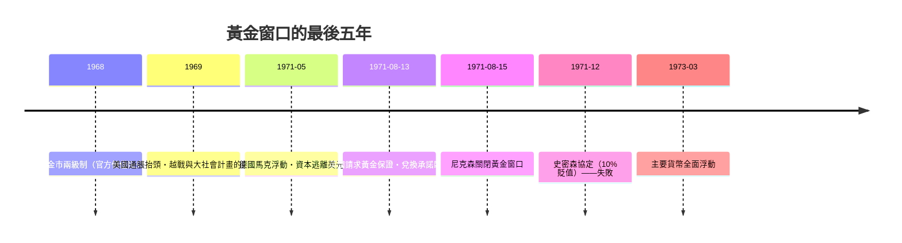

# 第四篇 第九章 第二節：尼克森衝擊與法幣時代——黃金的退場與「承諾」的重生

> 1971 年 8 月 15 日（週日）晚，尼克森總統在電視上宣布：**暫停美元兌換黃金**，同時施以 10% 進口附加稅與凍薪凍物價——**「我已指示財政部長採取行動保衛美元」**。**布雷頓森林的黃金承諾（1944–1971）就此終結**；1973 年主要貨幣全面浮動——**人類貨幣史進入「法幣（fiat money）」時代：貨幣的價值不再由任何金屬擔保，只由央行的行為與國家的信用擔保**。本節拆解：**黃金退場的五年倒數，與法幣時代的三大新問題**（《金融的故事》8.3 的貨幣視角重述）。

## 一、前因：兌換壓力的五年

1. **特里芬困境的兌現**（9.1）：美國逆差→海外美元氾濫→**外國持有的美元遠超美國黃金儲備**（1971 年黃金約 100 億美元，外債數倍於此）——**兌換承諾在算術上已不可行**；
2. **「國內政治優先」**：通脹與失業並存的**停滯**壓力下，**緊縮換取兌換承諾**在政治上不可行——**「內部平衡壓倒外部平衡」**——這是所有固定匯率體系的死因（8.2 的金本位教訓重演）；
3. **沃爾克的角色**：時任副財長的**保羅·沃爾克**是大衛營方案的設計者之一——九年後（1979）他以**殘酷緊縮「殺死通脹」**——**同一個人，先終結黃金承諾、再以法幣重建信譽**——**法幣的合法性靠「反通脹紀錄」掙回來**。

## 二、法幣時代的三大新問題

1. **「錨是什麼」**：**通膨目標制（1990 紐西蘭首創，其後全球普及）**——**以「2% 通膨承諾」替代「黃金兌換承諾」**——**從金屬錨到機構錨**：央行的獨立性、透明度與紀錄成為新的「黃金」；
2. **「信用無限擴張」**：沒有黃金約束，**全球債務與貨幣總量可以指數增長**——**2008 年 QE、2020 年疫情擴表**（11.1）在技術上不再受任何金屬限制——**「印鈔的邊界」從地質學變成通脹政治學**；
3. **「匯率的波動成為產業」**：浮動匯率創造了**外匯市場（日均數兆美元）與衍生品產業**（《金融的故事》9 章）——**風險從「體系設計」轉移到「私人對沖」**——這正是 1972 年金融期貨誕生的直接原因。

## 三、後果

- **「黃金的神話與現實」**：法幣時代黃金**不再流通、但未退場**——央行仍儲黃金、金價成為**「對法幣體系不信任的溫度計」**——2020 年代的央行購金潮與比特幣（11.2）的「數位黃金」敘事，都是**「無錨貨幣焦慮」的變奏**；
- **「信任的完全內生化」**：法幣把貨幣的擔保**全部寄託於制度行為**——**央行信譽、財政紀律、政治穩定**——**這也是 2008 年後「去中心化貨幣」實驗的動機**（11 章）；
- **思想史的分水嶺**：**「貨幣是社會建構」**從異端變成常識——**現代貨幣理論（MMT）與其批評者**、穩定幣與 CBDC 的辯論，都是 1971 年開啟的問題：**「當錢只是承諾，承諾需要什麼才能被相信？」**

---

*下一章：信用卡與數位化——參見 [10.1 信用卡革命](10.1-信用卡革命.md)*