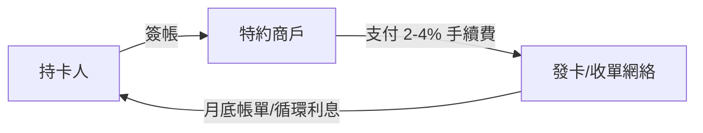

# 第五篇 第十章 第一節：信用卡革命——「消費信貸」的大眾化

> 1950 年 2 月，紐約商人**法蘭克·麥克納馬拉（Frank McNamara）**在梅傑烤肉館的傳說性晚宴後，創立**大來卡（Diners Club）**：**一張卡，兩百家餐廳簽帳，月底一次結清**——**「第三方支付卡」**誕生。1958 年**美國運通簽帳卡**與**美國銀行卡（BankAmericard，VISA 前身）**相繼問世；後者首創**循環信用（revolving credit）**——**「先消費、分期還、收利息」**——**消費信貸的大眾化時代**自此開啟。本節拆解：**一張塑膠卡如何同時發明「支付網絡、消費信貸、資料經濟」三樣東西**。

## 一、前因：戰後美國的消費社會

1. **「帳戶與簽帳」的既存習慣**：石油公司加油卡（1920s）、百貨公司記帳、旅店簽帳——**「本地信用」遍地、跨商家缺位**——大來卡的發明只是**把「信用」網絡化**；
2. **戰後的繁榮與 suburban 化**：分期付款（汽車、家電）已證明**「消費信貸可以規模化」**——**中產階級的消費慾望＋銀行的放貸能力**需要一個通用接口；
3. **技術條件**：**壓印機（imprinter）＋複寫單據＋電話授權**——信用卡先於計算機存在——**1970 年代才接入電子授權與磁條（1971 全國銀行卡系統的 VSS 磁條標準）**。

## 二、機制：三方網絡的發明

1. **「雞與蛋」的破解**：銀行卡早期**發卡虧損嚴重**（1961 年前後 BankAmericard 曾大量虧損）——**把卡「寄給」百萬人**（drop 郵寄）＋**特約商戶補貼**——**網絡業務的燒錢邏輯**在 1960 年代已被發明；
2. **「循環信用」的商業革命**：**從「月底還清」到「部分還款＋利息」**——**信用卡成為高利潤的消費貸款產品**——1970s–80s 美國各州**高利貸上限的解除**（1978 年 Marquette 判決後）使**南達科他、德拉瓦成為「卡業避稅地」**——**信貸定價的聯邦化**；
3. **「評分＋資料」的誕生**：持卡數據使**FICO（1989 通用分）與精準行銷**成為可能——**「支付數據=信用資本」**——這條線通向今日的行動支付與**數位信貸**（10.2、13 章）。

## 三、後果

- **「支付網絡的壟斷結構」**：VISA（1976 由 BankAmericard 系統改組）與 MasterCard 的**聯盟–品牌–清算**結構——**「網絡=規則＋品牌＋清算」**——2020 年代的**行動支付與穩定幣**（11.2）都在挑戰這張網絡，也都被迫重演它的網絡邏輯；
- **「信用社會」的雙面性**：**「信用分」決定利率與准入**——**普惠與歧視（算法偏誤）的張力**成為 21 世紀的監管議題（13.1）；
- **「債務文化的確立」**：美國家庭負債率在戰後持續攀升——**「先買後付」的每一代技術（信用卡→簽帳卡→BNPL）**都是同一文化的新包裝——**與《金融詐欺的故事》10 章的次貸（2008）同根**。

---

*下一節：SWIFT 與 ATM——參見 [10.2 SWIFT 與貨幣的數位化](10.2-SWIFT與貨幣的數位化.md)*