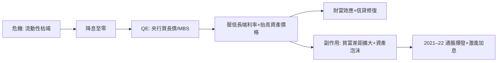

# 第五篇 第十一章 第一節：量化寬鬆與信任危機——印鈔機的極限測試

> 2008 年 9 月雷曼倒閉後，全球金融體系瀕臨凍結：**同業拆借停擺、貨幣基金破淨、商業票據市場關門**。**聯準會把利率降至 0–0.25%，並開始購買長期國債與抵押證券——「量化寬鬆（QE）」**——央行資產負債表從 2008 年的約 0.9 兆美元膨脹至 2014 年的 4.5 兆、2022 年巔峰近 9 兆。**「印鈔」一詞從隱喻變成字面**。本節拆解：**法幣體系（9.2）第一次以兆級規模自我擴張**——它避免了蕭條，也埋下了**「信任的裂縫」**——裂縫的另一邊，站著中本聰（11.2）。

## 一、前因：從「利率工具」到「資產負債表工具」

1. **傳統工具的極限**：**利率降到零後，經濟仍需刺激**——凱因斯的「流動性陷阱」與**日本的先行經驗（2001 年日銀首創 QE）**提供了劇本；
2. **「救誰」的道德風險**：**貝爾斯登被救（2008-03）、雷曼被棄（2008-09）、AIG 被救**——**「救助標準」的模糊**引發**「大而不能倒」的政治憤怒**——**佔領華爾街（2011）**與後續的民粹浪潮（茶黨與桑德斯兩翼）共同滋長；
3. **「貨幣理論的典範轉移」**：**「央行印錢買債＝銀行準備金增加」**——理論上**只要不通脹就無害**；實踐上**通脹未至（2009–2019）、資產價格大漲**——**「QE 的通脹去哪了」成為十年之問**。

## 二、機制的解剖

1. **「財富效應的分配問題」**：**資產持有人受益、無產者承擔房價與股價的入場門檻**——**貨幣政策的分配後果**首次成為主流政治議題——**「貨幣是政治」**（9.2 末）的當代演繹；
2. **「QE 沒有通脹、直到有」**：2009–2019 通脹長期低於 2%——**「印鈔≠通脹」的十年**；**2020 年疫情 QE＋供應鏈衝擊＋財政直撥**後，**2021–22 通脹衝上 9%**（美國 40 年新高）——**貨幣數量論的「條件性」被兩次實驗反向驗證**；
3. **「全球的溢出」**：美元 QE 使**新興市場資本氾濫→縮表時資本撤離**（2013 年「縮減恐慌 Taper Tantrum」）——**法幣時代的「美元週期」成為全球金融的核心風險**（《國家破產的故事》9–10 章的危機背景）。

## 三、後果

- **「央行獨立性的政治化」**：QE 的分配後果使**貨幣政策進入選舉議題**——川普抨擊聯準會、各國央行被要求「綠色化」（氣候目標）——**「機構錨」（9.2）出現鬆動**；
- **「財政–貨幣的融合」**：疫情期間**「央行買債＋財政直撥」實質是貨幣融資**——**MMT 的「理論」被部分實踐**——**「赤字是否仍有約束」成為 2020 年代的核心辯論**；
- **「信任的裂縫→技術的反叛」**：**「銀行被救、納稅人買單」的記憶**是 2008-10-31 比特幣白皮書發布的直接背景——**創世區塊刻著泰晤士報頭條「財相瀕臨第二次救助銀行」**——**一次貨幣制度的危機，孕育了一次對貨幣制度本身的反叛**（11.2）。

---

*下一節：比特幣——參見 [11.2 比特幣與無需信任的帳簿](11.2-比特幣與無需信任的帳簿.md)*