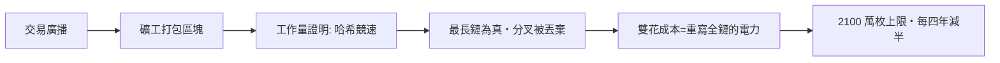

# 第五篇 第十一章 第二節：比特幣與無需信任的帳簿——五千年貨幣史的「程式化」結尾？

> 2008 年 10 月 31 日，筆名**中本聰（Satoshi Nakamoto）**的九頁白皮書《Bitcoin: A Peer-to-Peer Electronic Cash System》出現在密碼學郵件列表；**2009 年 1 月 3 日創世區塊挖出**，內嵌泰晤士報當日頭條——**「Chancellor on brink of second bailout for banks」**。**一個不依賴任何銀行、任何政府、任何主權的貨幣系統**開始運行：**以工作量證明替代準備金，以最長鏈共識替代央行，以 2,100 萬枚的硬上限替代「增發的誘惑」**。本節以全書視角作結：**比特幣是「1.1 貝殼的不可增發＋3.2 交子的紙＋5.1 阿姆斯特丹的帳本」的一次程式化重組**——它是終結，還是又一輪輪迴？

## 一、前因：四千年問題的一次性清單

| 全書問題 | 歷史解法 | 比特幣的解法 |
|---|---|---|
| 誰擔保稀缺？ | 貝殼的天賦、黃金的地質（7.2） | **演算法：2,100 萬枚、每四年減半** |
| 誰記帳？ | 神廟書吏（1.1）、銀行帳本（5.1） | **全網節點共同持有的公開帳本** |
| 誰防偽？ | 官印（3.2）、雕版與水印 | **橢圓曲線簽名＋工作量證明** |
| 誰清算跨國？ | 匯票（4.2）、SWIFT（10.2） | **點對點廣播，無需中介** |
| 誰約束發行者？ | 議會（6.1）、通膨目標（9.2） | **程式碼：任何人都不能增發** |

1. **密碼朋克的三十年積累**：**David Chaum 的盲簽名電子現金（1983）、Adam Back 的 Hashcash（1997）、Adam 與 Nick Szabo 的 b-money/bit gold（1998–2005）**——比特幣是**「去中心化電子現金」難題的最後拼圖**——**「雙花」問題**（同一筆錢花兩次）是核心死角，中本聰以**「最長鏈＋工作量證明」**破解；
2. **2008 作為動機**（11.1）：**「無需信任第三方」**（白皮書摘要第一句）直指**銀行被救助、客戶資產被挪用**的當年新聞——**技術方案的動機是一次政治事件的創傷**；
3. **「不可增發」的政治哲學**：**奧地利學派的「硬通貨」理想**（哈耶克《貨幣的非國家化》1976）在 2009 年獲得了**第一個可運行的載體**——**思想先於技術三十年，技術等到了危機**。

## 二、機制的解剖與代價

1. **「信任的物理化」**：**「相信」被替換為「驗證」**——任何人可下載帳本自行核對——**阿姆斯特丹銀行的「公開帳目」（5.1）被推到極致：人人都是稽核員**；
2. **代價一：能耗與中心化**——工作量證明的**電力消耗與礦池集中**（中國礦池一度過半，2021 年禁令後移居美國）——**「去中心化」的系統實際由數個礦池運轉**——**制度的重力重新聚集**；
3. **代價二：波動與投機**——**「數位黃金」的敘事與「貨幣」的職能互相矛盾**（價值劇烈波動使其難以計價）——**穩定幣（USDT/USDC）成為實際的「鏈上法幣」**——**繞了一個圈：法幣以新形態回歸**；
4. **代價三：詐欺的遷徙**——**交易所竊案、FTX 挪用（12.2，《金融詐欺的故事》12 章）、Terra 死亡螺旋**——**「無需信任的帳本」無法阻止「需要信任的接口」被騙**——**託管的問題四百年不變**（4.1 聖殿團、9.2 麥道夫）。

## 三、結語：貨幣史的「輪迴」與未完的故事

- **回望全書**：**貝殼（不可增發）→ 鑄幣（主權擔保）→ 紙幣（承諾）→ 央行（制度化承諾）→ 法幣（無錨承諾）→ QE（承諾的極限測試）→ 比特幣（撤銷承諾者本身）**——**每一次進化都是對上一代「失信」的回應**；
- **國家的回應**：**CBDC（央行數位貨幣，中國數位人民幣 2020 試點、歐洲數位歐元籌備）**——**主權收編了「帳本技術」，但拒絕「去中心化」**——**「誰的帳本」之爭（5.2 末）進入數位紀元**；
- **最後一問**：**貨幣的本質從來不是金屬、紙張或程式，而是「陌生人們對一份共同帳本的相信」**——五千年來，這份相信**寄託過神殿、王印、議會與演算法**——下一份帳本由誰持有、如何驗證、能否被濫用——**故事沒有終結，它只是換了介質**。

---

***全書完***——延伸閱讀：《金融的故事》《會計的故事》《金融詐欺的故事》《國家破產的故事》《法律設計者的故事》