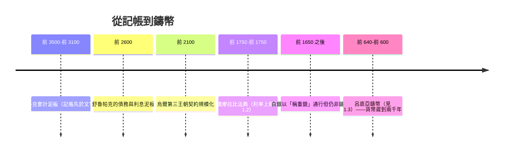

# 第一篇 第一章 第一節：泥板上的神廟帳目——比貨幣更早誕生的信用

> 公元前 2000 年前後，烏魯克、烏爾、尼普爾的神廟倉庫。書吏用**細蘆葦筆在溼泥板上按壓楔形文字**，記下「他欠神廟大麥」、「收成時以銅或白銀償還」。**藝術史的事實冰冷而驚人：金融——無抵押的信用與帶息的借貸——比鑄幣早了大約兩千年。**貨幣不是金融的起點，記帳才是。

## 一、前因：神廟經濟的規模化

蘇美爾城市（前 3500 年 – 前 2000 年）的經濟引擎：

1. **神廟＝大型經濟組織**：土地、畜群、勞動力（客工、奴隸）、倉儲——必須**跨年度、跨人員**管理；
2. **農業的年度循環**：播種前借出種子糧、收成後回收＋利息——**「時間差」就是金融的第一性原理**；
3. **書吏階層＝教育制度**：埃杜巴（edubba，泥板書院）訓練書吏十年——**「會計」是最早的精英職業**（詳見《會計的故事》1.1–1.2）。

考古實據（地點與時代）：

| 泥板證據 | 年代 | 內容 |
|---|---|---|
| 烏魯克（Uruk） | 前 3300 年 | 倉儲符號版——**記帳先於文字**（楔形文字極可能源於會計） |
| 烏爾第三王朝（Ur III） | 前 2100 年 | 成批的**貸款合同泥板**：本金、利率、擔保人、期限 |
| 古巴比倫 | 前 1800 年 | **帶利息的「用銀借銀」契約**標準化 |

## 二、金融的四個「原始發明」

古代兩河的契約已包含現代金融的所有核心要素：

1. **利息**：寫作「máš」（小牛犢之意——**利息的隱喻是「牛在牧場上長出的牛犢」**）；銀的年息常為 **20%（1/5）**，大麥為 **33%（1/3）**；
2. **期限與複利觀念的雛形**：「收成時償還本金與利息，逾期以物抵債」；
3. **擔保人與抵押品**：第三人擔保（有泥板存世）、田地房屋設定擔保；
4. **早期的信貸危機與「債務赦免」**：蘇美爾諸王與漢摩拉比均行「**米沙魯姆（misharum，清債令）**」——取消個人債務、免抵押贖回——**史上第一次「債務危機的政治解法」**（可對照《國家破產的故事》1 章）。

## 三、後果：金融早於貨幣的意義

- **「沒有貨幣也可以有金融」**——這一考古結論改寫了教科書：金融的原點是**跨時間的承諾（promise across time）**，貨幣只是讓承諾更易計量的工具；
- **契約名義標的以白銀計**，但**結算可用大麥、毛織品、勞務**——**「計價單位／支付手段／價值儲藏」三職能分離**，經濟學家（Innes、Graeber 之後的修正理論）由此重解貨幣史；
- **制度遺產**：泥板文書→《漢摩拉比法典》（1.2）→希臘銀會（本書 1 章後續）→羅馬金融——**一條從「神廟倉庫」到「現代銀行」的連續鏈條**。

---

*下一節：把「利率上限」與「債奴」寫進石柱的人——參見 [1.2 漢摩拉比法典中的金融法規](01.2-漢摩拉比法典中的金融法規.md)*