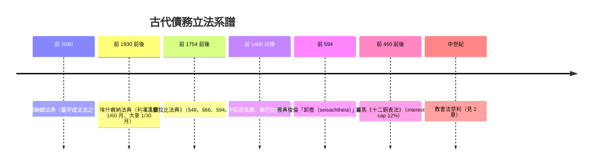

# 第一篇 第一章 第二節：《漢摩拉比法典》中的金融法規——利率上限、抵押與債奴的文明談判

> 公元前 1750 年前後，巴比倫。**漢摩拉比（Hammurabi）**派人把一根近兩米半高的玄武岩石柱豎立於神廟之前：序言自述「使正義昌明、使邪惡消滅」。282 條條款中，金融法規的密度驚人——**利率上限、債奴期限、抵押品保護、託管投資責任**——這是世上最早的**成文金融管制**。石柱上的條文不只是震懾：它是人類第一次承認——**借貸關係太重要，不能只交給借貸雙方。**

## 一、法典中的金融條款（真實原文結構）

| 條款區 | 內容 |
|---|---|
| §48 | 債務人耕田遭遇**洪水／旱災**歉收，**當年停息、本金順延**——「不可抗力條款」 |
| §49–52 | 田地抵押耕作：第一年後還本付息；災年**停息**；受託耕作失火等責任界分 |
| §53–56 | 田埂潰堤沖毀鄰田按產量賠償 |
| §66 | 委託資金給「塔木卡」（商人 tamkarum）合法經營，須立契、點收清單——**早期「託管投資／生意合夥」** |
| §94 | 收受本金後**重計利息**者：應退回已收利息並只按本金索償——**打擊複利滾債** |
| §94–96 之間 | 受託轉手經營虧損時，商人須按出資額賠償本金——**「虧損責任條款」** |
| §114–116 | 質押人（債務人自押勞力）在債主家中受虐、被賣、死亡——**債主賠償／處死規定** |
| §117 | 債奴（因債自賣或家人自賣）**三年即釋放**：「第四年恢復自由」 |
| §118–119 | 押入勞動與妻子等家眷做債奴的特殊規定 |

**核心設計邏輯**：上限管利率（通行契約月息 1/60（銀）至 1/30（大麥），折年息約 20%–33%——法典把**慣例寫成法律**）；限制人身擔保（債奴必須到期釋放）；強制風險分擔（天災停息）。

## 二、前因：為什麼巴比倫需要「債務政治學」

- **銀本位＋歉收＝債奴化**：小農借銀還銀，歉收年賣兒賣女——**社會成本由王權吸收**；
- **王朝治理邏輯**：清債令（misharum）新王登基、重大災年必行——**「免債」是王權比起私有產權更早期的合法性來源**；
- **商人（tamkarum）與王權共生**：王需要商人經手長程貿易與稅收，商人需要王法保障履約——**法典是「權力與資本」的第一紙協議**。

## 三、後果：影響一千五百年的債務立法系譜

1. **「利率上限」成為文明法律的常備藥**——今日各國對高利信貸（high-cost credit／loan sharking）的管制，與羅馬法年息上限的 12%（見 timeline）皆思同源；
2. **「人身擔保 → 財產擔保」的歷程**：從債奴、債人家屬擔保，到梭倫廢止債奴——**金融現代化的標誌之一是「債不能使人成為財產」**；
3. **法典的地產抵押與託管條款**，為後世（包括 1900 年德國民法典的抵押制度）提供了制度史脈絡——**「可預期的法律＋可執行的契約」是資本的第一道路面**。

---

*下一節：呂底亞金銀鑄幣——貨幣的「終極技術」——參見 [1.3 呂底亞鑄幣與金銀複本位](01.3-呂底亞鑄幣.md)*