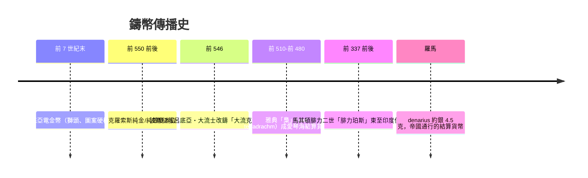

# 第一篇 第一章 第三節：呂底亞鑄幣——「標準化」比黃金本身更革命

> 公元前 7 世紀下半葉，小亞細亞西部的**呂底亞（Lydia）**王國，薩爾迪斯城傍著帕克托羅斯河（Pactolus）——河漢沙中淘得出「白電金（electrum，金銀天然合金）」。呂底亞諸王把這種天然合金**打成規定重量、加蓋獅頭印章的圓片**。印章不是裝飾：它是**王權對「這枚金屬有多重、含多少金」的擔保**——人類第一批鑄幣就此誕生。

## 一、前因：稱重時代的結算成本

呂底亞之前，白銀通行於兩河模式：**每次交易都要戥秤、剪塊、驗純**（可對照《會計的故事》1 章的「稱重銀」）。

- **三重成本**：實驗（測純度）、計重（精度）、博弈（爭秤）；
- **呂底亞的獨特條件**：本地河沙電金＋緊鄰希臘世界市場＋扼守愛奧尼亞諸城與安納托利亞內陸的**貿易要道**；
- **政治動機**：呂底亞人默姆納德斯詩歌之外的記述後世所傳，呂底亞先王**阿魯阿特斯（Alyattes，前 619–前 560 年）**大規模鑄電金幣、其繼承者**克羅索斯（Croesus）**改鑄**純金與純銀雙套**貨幣——金銀複本位由此成型。

## 二、技術與設計：貨幣的三個「規格化」發明

1. **重量標準**：斯塔特（stater）及其系統分度（1/2、1/3、1/6、1/12）——**使金屬交易「可數」而非「稱測」**；
2. **防偽標記**：**硬模沖壓**（一正一反模具擊打成像）——**把「仿冒成本」技術化**（後世交子雕版、現代鈔票水印的原始思路）；
3. **法定面值**：把「含金量＋重量＋王印」**固化為標準**——**「面值」的概念由此誕生**：面值不只是金屬重量，而是**「王權對重量的承諾」**。

克羅索斯時代以降，呂底亞**並發純金幣與純銀幣**，並以法令規定金銀兌換關係——**金銀複本位**成型，呂底亞金幣也被近東廣泛用為**儲備與結算貨幣**。

## 三、後果：傳播與「鑄幣的代理人問題」

1. **貿易成本的驟降**：沖印貨幣使**跨文明結算**可能——呂底亞位於東西商路，鑄幣成為「**貿易的通用語言**」——希羅多德所言「呂底亞人是最早開旅店（市場）的民族」非全然附會；
2. **「鑄幣的名字可以騙人」**：羅馬銀幣含銀量從 denarius 的 >90%，一路稀释至 5% 以下（《國家破產的故事》1 的主題）——**「王印擔保」被王權自己打破**：貨幣擔保終究看發行者行為；
3. **金融史的主軸成立**：從呂底亞到 CBDC，貨幣史唯一的恆量是**「標準由誰設定、由誰受騙」**——本書第五篇（比特幣、CBDC）將回到這個問題。

---

***第二章：佛羅倫斯與美第奇——避開「重利罪」的銀行家——參見 [2.1 美第奇家族的結構](02.1-美第奇家族的結構.md)***