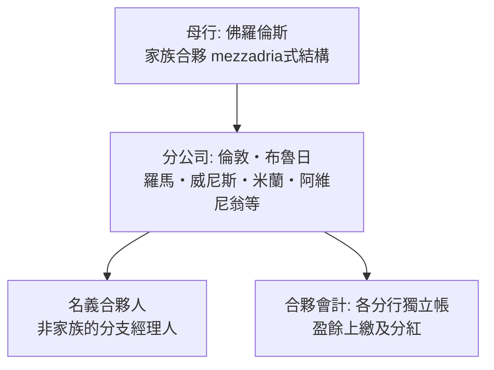

# 第一篇 第二章 第一節：美第奇銀行的結構——如何在「重利罪」的眼皮下做銀行

> 1397 年 10 月，佛羅倫斯。這一天還是美第奇家族日後宴會上都會提起的日子。**喬瓦尼·迪·比奇·德·美第奇（Giovanni di Bicci de' Medici）**在兩次失敗經驗（父亲的錢莊與堂兄的分支行）之後，創立**美第奇銀行（Medici Bank）**。教會法說「**放貸收息即重利罪（usury）**，罪在道德、可嚴於死刑」——而美第奇銀行的**三層結構**，正是整個文藝復興時代的「**合法律套利**」。

## 一、前因：中世紀信用的約束條件

- **教會的禁利令**（12 世紀列日會議、1234 年教令集系統化）：**借貸收息為罪**——從聖哲爾母（西方教會神學）到湯瑪斯·阿奎那：「錢不能生錢」——**猶太人被動成為歐洲的放貸者**（因猶太法僅禁「向兄弟放貸收息」，基督教徒間的禁利漏洞在教外）；
- **商業現實的另一邊**：長程貿易（香料的自亞歷山大城至佛羅倫斯）、政治貸款（教宗、王侯）——**資本必須跨時間、跨政治域流動**；
- **佛羅倫斯的獨特土壤**：毛紡行會的工業信用、複式記帳的商業文化（本書 2.3 將入帕喬利）。

## 二、結構設計：美第奇銀行的三件套

1. **「分公司→合夥」結構**：各分行**外聘經理人持有小股份**——利益綁定＋當地法規下「本地人經營」的形式要求（許多城市禁止外國人做銀行）；
2. **「佣金結構」**：對外掛牌**不收利息**——收的是「**匯兌折扣**」與「**風險補償（periculum sortis）**」——**把利息藏進匯率**；
3. **「aequitas（衡平）」投資合夥**：銀行投資羊毛行、貿易船隊**以分紅形式回收資本**——**盈虧共擔（risk-sharing）的民事結構**。

### 「匯票藏息 » 的機制（細節配合 2.2 節完整攤開）：

- 佛羅倫斯商人向倫敦分行「買」一張**匯票**：今日在佛羅倫斯付 100 佛羅林，**90 天後在倫敦支取一定數量的英鎊**；
- 匯率本身，在約定時點就**內嵌了時間上的貼水**——**利息以「匯率」之名收取**，在法律上這是「外匯交易」，不是「貸款」；
- 這套技術在 14 世紀義大利商學院（算盤學校）已成教案，**美第奇把它規模化與組織化**。

## 三、後果：權力的副產品

- **財富→政治**：科西莫（Cosimo il Vecchio）以「非官位」實質統治佛羅倫斯；**美第奇教宗（利奧十世、克萊門特七世）**——**金融資本向神權頂層轉化**；
- **風險的代價**：1464 年後分行失控（倫敦分行連年虧損、布魯日貸款於勃艮第）、1494 年因**薩伏那洛拉**與法國查理八世入侵被趕出佛羅倫斯——銀行關閉。**「銀行無法與政治解耦」**是其終局的教訓；
- **制度遺產**：分行合夥＋集中帳務審查，**實質上是「銀行總管理處＋分支行審計」的原始形態**（後世的羅斯柴爾德、荷蘭貿易公司在結構上有同源）。

---

*下一節：匯票如何隱藏利息，並成為跨國資金轉移的「暗道」——參見 [2.2 匯票的發明](02.2-匯票的發明.md)*