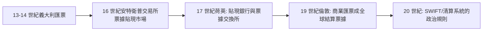

# 第一篇 第二章 第二節：匯票的發明——把利息藏進匯率、把資金變成「不流動的紙」

> 13 世紀的熱那亞與香檳集市（Champagne Fairs）之間，商人發明了一張「**三簽名可用**」的紙：今天在 A 城付錢，**三個月後到 B 城取錢**，收款人可以**背書轉讓**。這張紙有三個身份：**支付工具、信用工具、以及「繞開重利罪的暗道」**。它是歐洲的**第一張可轉讓金融資產**——也是現代商業票據、國際結算乃至 SWIFT 的祖先。

## 一、前因：跨城邦結算的兩難

香檳集市時代（12–13 世紀）的問題：

1. **道路與治安**：義大利商人攜帶金銀穿越阿爾卑斯——**劫掠、關稅、錢袋風險**；
2. **貨幣碎片化**：佛羅倫斯的弗羅林、威尼斯的杜卡特、法蘭西的里佛、英格蘭的便士——**一城一幣，兌換差異本身即商機也即風險**；
3. **重利禁令**：倫巴德人和香巴尼人不能「放貸收息」——**決不能開「借條」**。

14 世紀起，先在熱那亞、佛羅倫斯、威尼斯商人之間，**「遠期匯款＋口水帳（cambium per litteras）」**結構成熟；15 世紀托斯卡尼地區的商學校（abacus schools）把它作為**標準教案**（可參照 2.3 的商業算術教材運行）。

## 二、機制：一張匯票的「三重奏」

**制度結構**：實在的事實可以還原成這樣一筆：

1. **購票**：在佛羅倫斯，倫敦買家 A 欠佛羅倫斯賣家 B 55 英鎊的貨款。B 需要佛羅倫斯現款，於是**買入匯票**：由佛羅倫斯「出票人」向倫敦「付款人」開出，指示倫敦在**三個月後**把某數額英鎊付給 B 在倫敦的指定人；
2. **兌換率內嵌貼水**：經多方角力後達成的**匯率**：佛羅倫斯今日付 100 佛羅林，倫敦三個月後付某數額英鎊（相對即期市場比價有增減）——**「增減」就是利息，但法律上這是外匯交易，不是放貸**；
3. **背書轉讓**：13 世紀在熱那亞萌芽、14 世紀（義大利最早的背書紀錄）走向**「第三人持票追討」**——**票據從「雙方約定」變成「流動資產」**。

| 發明 | 意義 |
|---|---|
| 三個月「不見面」結算 | **資金零實體移動**——繞過路途與劫掠 |
| 匯率 vs 利息的通金差 | **把「重利罪」消解為商業匯兌** |
| 背書轉讓 | **票據從『私人合同』變成『公共貨幣』**——現代信用傳遞的雛形 |
| 日期＋兌付地＋簽名 | **可訴訟性**：中世紀法庭開始認可信券票據 |

## 三、後果：一張紙怎麼生出了一整套金融

- **利率市場後來居上**：延遲結算的機會成本先由匯率吸納——因此**中世紀的「匯率市場」先於「利率市場」誕生**，直到 16 世紀「乾貸（dry exchange）」被禁，利息才被迫另尋形式；
- **信用傳遞與 Lodi's "bill on London"**：**19 世紀的「倫敦票據」作為全球單一結算標準**——**比美元成為世界貨幣早了一百五十年**；
- **政治意義**：教會法學家最終承認「**國際匯兌可收費**」（15 世紀方濟各高級神學家的寬疏）——**「金融創新總在法律的夾縫中開路，而法律最終追認」**，這一模式在 20 世紀的衍生品與 21 世紀的加密貨幣中重演。

---

*下一節：把這一套寫成教科書的人——參見 [2.3 帕喬利與複式記帳](02.3-帕喬利與複式記帳.md)*