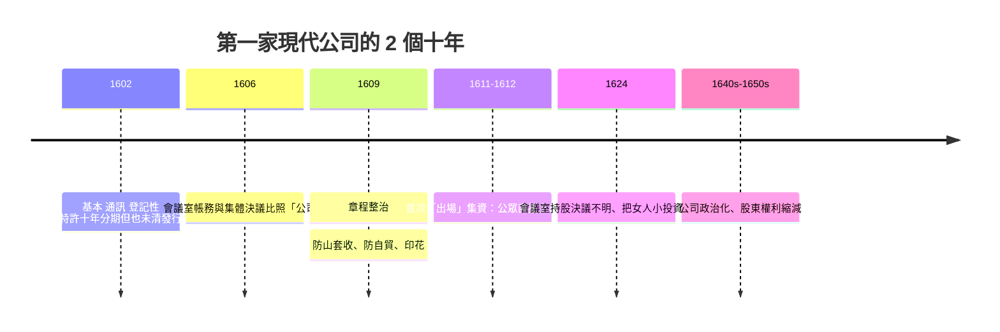

# 第二篇 第三章 第一節：VOC 與第一張股票——「公司」如何成為可以買賣的發明

> 1602 年 8 月，「荷蘭東印度公司（Verenigde Oostindische Compagnie, VOC）」以**勸募章程**向公眾集資。任何人可以到阿姆斯特丹交易所新落成的大廳登記繳款；446 年後的歷史學家回頭看，發現章程裡出現了一個**前無古人的句子**——出資者不必等待船隊回港，也**可以在交易所出售其「一份」投資**。那「一份」就是**股份（share）**；那個「可以出售」就是**股票市場**。

## 一、前因：香料航路為什麼必須「公司化」

1. **香料貿易的超額利潤與超額風險**：胡椒、肉豆蔻、丁香從摩鹿加群島至阿姆斯特丹，利潤率高，但**一船十不回一**（風暴、海盜、葡萄牙人）；
2. **搶亂的先行者**：1594–1598 年間荷蘭成立多家小公司（van Neck、Houtman 等）各自競爭買船、競價香料——**同業內部競價把利潤推薄、把風險放大**，政客與商人得出同一結論：**合併為一家、壟斷亞洲貿易**；
3. **政治保護的需求**：與葡萄牙、西班牙打海外戰爭需要**國家式的武器與艦隊經費**——私人資本不足以武裝，必須**「國家的戰爭＋公司的經營」**。

### 新發明：四項相互咬合的制度

| 制度 | VOC 的規定 | 意義 |
|---|---|---|
| 有限責任 | 出資以繳付為限，公司事務追責不追到股東個人 | **風險從「傾家蕩產」到「最多賠完投資」** |
| 永續存續 | 合約十年，但**可續約；帳務按「一般帳」記** | 公司壽命**獨立於個人壽命**——「法人」的經濟意義 |
| 公開勸募 | 任何人（連「小人物、婦女」）可認購 | **資本從親友圈變成公眾市場** |
| 可轉讓 | 出資者可**轉售繳付額（inregistratie）** | **資本可退出**——「股票」誕生 |

## 二、第一批股東的形態

- **阿姆斯特丹會所得資本的一半左右**，但**面額分布極廣**：最小出資者僅數十盾（工匠、寡婦都有）——**「公眾公司」名副其實**；
- **六大城市的會議室（Kamers）**分別持權、召集——**制度設計為「分散決策＋中央聯督」，防單一城市壟斷**；
- **第一次定期定息**：**1610 年首次發行給股東 8% 年息的紅利記錄**——**「現金流權」成為可計算資產**；

## 三、VOC 的「實驗失效」與修正

1. **「法人」成為國家工具**：VOC 自帶外交、軍事、司法、鑄幣權（與英國東印度公司同類）——**公司的「人格」與「國家的戰爭」合流**：《法律設計者的故事》稱為「**Corporate Sovereignty**」的遺產；
2. **紅利賒欠與股東代理困境**：120 年間 VOC 幾乎全靠「股價上漲」給股東回報——**「公司治理」的現代難題在第一家公司就出現**；
3. **教育的回響**：16 世紀末荷蘭大學（萊頓等）的**商學、水文學與法學**配合商業實踐的人才培養——大學知識與貿易資本第一次形成產研循環。

---

*下一節：同一棟交易大廳裡的期貨與賣空——參見 [3.2 阿姆斯特丹交易所](03.2-阿姆斯特丹交易所.md)*