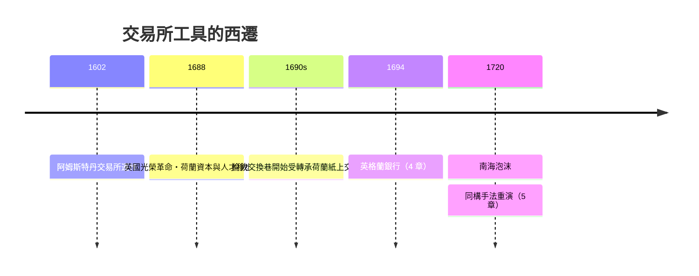

# 第二篇 第三章 第二節：阿姆斯特丹交易所——期貨、選擇權與賣空的誕生地

> 1611 年，阿姆斯特丹新落成的交易所大樓開門，鐘聲驅使上千人聚集。這裡交易的先是 VOC 認購憑證、聯省國債、遠洋船隊保單；到 1620 年代，**「遠期紙上交割」的各種花式玩法**——**期貨、選擇權、賣空**——都已在此流通。現代衍生工具的整個陣形，在四百年前的這個大廳已經**列隊就位**。

## 一、前因：信息的商品化

- **1610–1612 年荷蘭第一次市場動盪**：VOC 船隊回報不如預期，股價下跌、認購者拋售——**VOC 總會因此動議限制拋售**（反賣空訴訟由此見於史冊）：**「你可以賣你還沒擁有的股」這一行為從誕生就被打上「可恨」標籤**；
- **信息基建**：17 世紀阿姆斯特丹**新聞小冊與船舶掛記**（準時船舶到港公告）、**價格行情傳單**形成——**「價格本身成為可流通的信息商品」**。

## 二、衍生工具的原始形態（史冊可考）

| 工具 | 1720 前的荷語名稱 | 現代對應 |
|---|---|---|
| 遠期買進 | "sollicteer"（求購） | 做多遠期（long forward） |
| 空頭賣出 | "windhandel"（風上生意） | 賣空（short sale） |
| 買權 | "buitenklaar" | 看漲期權（call option） |
| 賣權 | "doorschuiven／dinghandel" | 看跌期權（put option） |
| 抵看時對沖 | 拋現券購遠紙 | 套利／對沖（hedging） |

**17 世紀荷文市場小冊與價格表的史料顯示**：遠期與期權交易在阿姆斯特丹已是尋常事；1690 年代倫敦的「紙上生意」（trade in paper）由跟隨荷蘭實務的交易者系統引入。

## 三、後果：倫敦是如何「學走」阿姆斯特丹的一切

1. **「荷蘭病」的意外效果**：黃金時代的人才（雨格諾流亡者、猶太商人群體）隨信教／政治變動**大量西遷倫敦**——阿姆斯特丹替倫敦培養了半支「軟實力」隊伍；
2. **監管的故事先後重演**：荷蘭禁賣空（1610 法案）→ 倫敦禁賣空（1697、1734 法案）→ **工具不死，只是轉入地下**，直到 19 世紀顛倒式回歸；
3. **「泡沫時代共同遵循的規律」**：**金融工具的演進先於法律，法律先於社會的語言**——在每一篇的章節中，這條規律都將重複出現。

---

### 補充：同一棟大樓裡的另一場「遊戲」

同一批交易所人群，還瘋狂著**「要價」另一類稀缺商品**——不是股份，而是**花**。下一節：1637 年的鬱金香，人類第一場資產泡沫。

---

*下一節：鬱金香狂熱——參見 [3.3 鬱金香狂熱](03.3-鬱金香狂熱.md)*