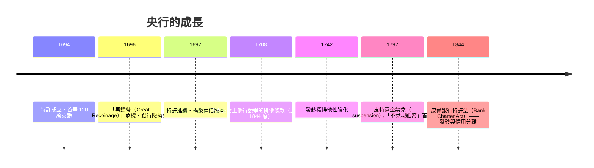

# 第二篇 第四章 第一節：英格蘭銀行的誕生——把國家借給自己的人

> 1694 年 7 月 27 日，倫敦。威廉三世剛從愛爾蘭戰場回來。法王路易十四的軍隊攔在英吉利海峽對面，戰爭財政使王室債台高築。這一天，一支以蘇格蘭商人**帕特森（William Paterson）**為首的財團，向國王交付了**1,200,000 英鎊**——年息 8%、每年 1 萬鎊管理費，**條件是用這筆錢及經理人組建「英格蘭銀行（Bank of England）」、享有有限責任與皇家特許**。央行不是「發明」出來的——**它是戰爭財政的副產品**。

## 一、前因：英格蘭的信用條款

1. **斯圖亞特王朝的賴債前科**：查理一世的「造幣廠剪髮」（1640 強行扣留倫敦商人存於倫塔爾的金幣）、1672 年查理二世的「**停付國債（Stop of the Exchequer）**」——**王室自身的信用極低**，借貸利率比荷蘭貴且期限短；
2. **1688 光榮革命後的新框架**：荷蘭統治者承諾**議會批准新稅**（《權利法案》與財政權）——**「錢無主 → 錢有議會」**；
3. **「長期財政」的技術基礎**：財政大臣（如 1690s 的 Godolphin、Montagu）以**土地稅＋關稅＋消費稅**做為可計算的償付來源——**「未來收入流」第一次被證券化**（與《國家破產的故事》5.1 漢密爾頓「專門收入流」同一道理——早一百年的英版）。

## 二、銀行的四重功能（初始設計）

| 功能 | 條例 | 意義 |
|---|---|---|
| 財政代理人 | 為王室收稅、發餉 | **「稅款入口」與「支出出口」都走它** |
| 貼現 | 對合格匯票**貼現** | **流動性供給** |
| 存款與轉帳 | 記帳轉帳、存款利息少而安全 | **「安全池」** |
| 發鈔 | 發行"許諾兌付"的**提款憑證**（promise to pay） | **紙幣**（最初以「即付」承諾、非法幣） |

## 三、經營與「央行化」的十年

1. **「議會擔保」使利息降下來**：以「專項收入流」償息，英國國債利率由 1690s 的 8–10% 降至 18 世紀中期的 3%——**「議會主權＋專款」的財政結構使借貸成本連續下降**（《國家破產的故事》4.2 法國的反例）；
2. **發鈔與「最後貸款人」**：1720 年南海危機、1763、1772–73、1797 年——銀行多次充当「**緊急放貸者**」；**Baring 危機（1793、1803）**正式形成「**lender of last resort**」的說法（巴傑特 1873 的《朗巴德街》將系統化此理論）；
3. **道德風險的三階段**：以「自己承擔風險→央行救助→立法監管」的螺旋，使「**央行成為神聖的戰場**」——1844 年皮爾法同時保留了「沙漠除名、不阻發鈔」的條文。

## 四、後果

1. **世界第一個「長期信貸支持的現代政府」**：1700 年英國跟法國公債成本與期限雙重優化，**英國得以進行「全球範圍陸海戰爭」**——金融使英國在「18 世紀的軍備競賽」中勝出（《國家破產的故事》3.2 西班牙的反面）；
2. **「央行 = 財政補丁」原型的確立**：這一路徑**複製到法蘭西銀行（1800）、荷蘭央行（1814）、德意志帝國銀行（1876）與各國央行** ——「央行」終極原型來自1694；
3. **「政治—IMF」與現今貨幣體事的雛形**：**「財政 → 央行 → 發鈔 → 國際儲備」四步走**——到 7 章大蕭條與 8 章布雷頓森林，這一條鍊條將成為「世界貨幣體系的國際化」地基。

---

*下一節：國債——參見 [4.2 國家債務的制度化](04.2-國家債務的制度化.md)*