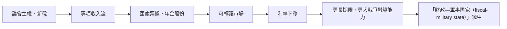

# 第二篇 第四章 第二節：國家債務的制度化——從「王家的錢」到「國家的信用」

> 1694–1712 年間，英國的借貸結構出現了一次「**正規化革命**」：**國王的私人欠債，逐步被「公共信貸」取代**——債權人從「借錢給某位君王的人」，變成「持有一張**議會批准、以稅收償付、可自由轉讓**的國庫證券的人」。這一轉換的精神核心只有一句話：**「誰償還」比「多少利率」更重要；「誰做擔保」比「金子」更可靠。**

## 一、前因：從「國王私債」到「公共債務」

| 階段 | 制度 | 特點 |
|---|---|---|
| 17 世紀前 | **王室私債**（由君主以收入擔保） | 君主死亡即債務爭議；償付隨君王個人品行 |
| 1690s | **議會認代償付**（土地稅、關稅、消費稅專項） | 償付來源**「法碼」化**、可計算 |
| 1710s–1720s | **南海「紙上轉換」**（5 章）：年息公債轉為可交易股份 | 公共債務成為**可轉讓資產** |
| 1750s | **「永久國債」（consols）**：3% 永久年金、無到期日 | 「**永續債券**」誕生——國家好似「永續企業」 |

**why**：光榮革命後，天堂般結合的（1）**議會主權**（誰的錢加新稅、由全民代表定）、（2）**可執行的司法**（王家法庭必須對國家本身也有拘束力）、（3）**市場化的清算**（倫敦金融城、阿姆斯特丹）——**三支柱下的借貸成本成為歷史最低**（North & Weingast, 1989 為經典論文）。

## 二、信用的「三重門檻」

1. **新稅須經議會批准**：「**不經議會同意，不得加稅**」（1689 權利法案條文）——議會握有第一手的財政權，**「不批准，無借貸」**；
2. **賠債藏在司法圈內**：**財務法規不向國王豁免**——簽約者上是「**議會立法**」，不只有王的屠刀；
3. **利息優先權**：**「先至 1/6（利息）」**的權利被擔保，王室**不會用「其它稅源」繞道**（強制信用的法律構造）；
4. **轉讓的技術**：**國庫期票、年金與股份**在倫敦交易所自由轉手——**「資產的流動性」使利息不再需要靠信仰**。

## 三、後果：金融資本與帝國的能力

1. **「永續年金」成為歐洲的「安全資產」**：3% consols 是 18 世紀全歐{@與}做「儲備」的標準安全資產（地產、黃金重铸之外的新選項）——**「無風險利率」的原典發明**；
2. **「公債公共性」合成的洲際影響**：美國（1790）與法國（1800）的「**重建信用**」四件套（承認債務＋專門收入流＋央行＋公開市場）——分別見《國家破產的故事》5.1；
3. **「永續債」的思想含義**：公債跨世代償付，使「代際公平」的政策辯論早早出現（亞當·斯密《國富論》第三卷抨擊公債的破壞；後世經濟學家反覆重審「公債是否轉嫁未來世代」）——**這是金融理論的第一場「公債戰爭」**。

---

*下一節：約翰·勞與南海——參見 [5.1 約翰·勞的紙幣實驗](05.1-約翰勞的紙幣實驗.md)*