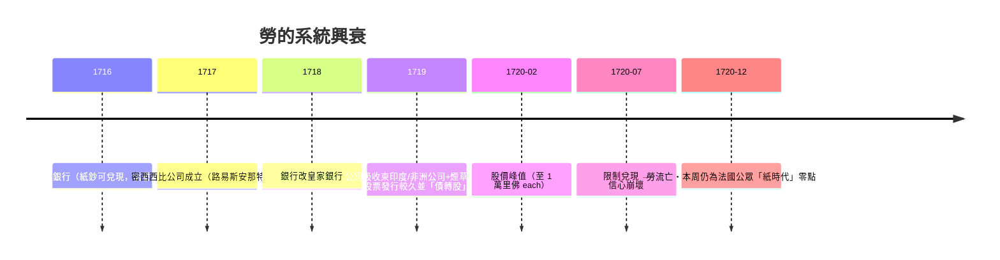

# 第二篇 第五章 第一節：約翰·勞的紙幣實驗——理論先行、體系後崩

> 1705 年向蘇格蘭議會提案、1706 與 1713 年輾轉於歐洲多國宮廷——**約翰·勞（John Law, 1671–1729）**到處兜售同一個理論：「**貨幣比金銀更重要；以紙鈔與銀行信用驅動，可以讓一國經濟復甦**」。直到 1716 年，法國攝政奧爾良公爵終於給了他機會。本節拆解：**一份先見性的貨幣理論，如何在實踐中變成 1720 年的災難**（參見《國家破產的故事》4.1、《金融詐欺的故事》4.1——三本書從不同角度重看同一事件）。

## 一、勞的理論：三個命題

1. **貨幣供給刺激貿易**：貨幣數量不足抑制交易促成壓力——**「紙幣代替金銀，資本則活跳」**（在 1705 這是超前五十年的思想）；
2. **發行須有擔保可兌**：勞主張紙鈔**以土地為質**（直係物質擔保；如銀行保證收到存款、可兌換等值金屬）；問題——他實際上放棄了純粹紙質發行，以**「合夥公司資產 + 國家稅收」混合承諾**；
3. **分業分工**：銀行（發鈔）＋公司（貿易/稅收）應「**雙軌而相互支持**」——**「央行 + 特許公司 + 股市』三位一體」，是 1716 後法國治理結構的原始圖。

## 二、操作時間軸

**誘因的彼此強化**：

- 「**全部商品流動稅由一家公司收**」→ 公司營收**看似無限**；
- **銀行放鈔購股**（「new shares paid for by notes」）→ **股價上漲驅動發行** → 更鈔、更股——**最古老「券式印鈔」**；
- 法國公眾在平民泡沫盛行的街道（新書合理性**《Système》組織的廣告**）妥協已無退路。

## 三、崩潰：心理學的經典

- **「改軌」**（限制兌現、強制持鈔、封印金銀）**→「不能兌現的鈔就是廢紙」**：泡沫券的一部分**法律取消市場**——**「才買一年就能在地板上漲十倍」** 為後世證券狂熱的模板；
- **「坎康普瓦街的葬禮」**（1719–1720 巴黎坎康普瓦街聚集數十萬洋洋得意與破產的投機者）——**「一場金融實驗失去信用基礎，只會以『大者越壞』收場」**的先例。

## 四、後果

1. **法國「紙創傷」**：約 100 年不信任紙鈔與股市——**「法蘭西銀行 1800」承諾與「金屬主義」的歷史底色**：《國家破產的故事》4.2 詳細聯動；
2. **英國直接吸取教訓**：1720 年英國通過**「泡沫法案（Bubble Act）」**，以特許制約束公司設立；同時事後**「南海案審判」（1721）**多名官員定罪——**「限制投機性發行、強化股東責任」成為歐陸後續公司法的發端**（下一節展開）；
3. **現代文獻成形**：勞體系在 1930s 的哈耶克會議、《貨幣與信用理論》及其後的巨觀理論討論中**反覆被引用**——**「貨幣量的『數量方法』，即使在發鈔被迫過度時也會失效」**——宏觀政策的黃金教訓。

---

*下一節：南海泡沫與牛頓——參見 [5.2 南海泡沫](05.2-南海泡沫.md)*