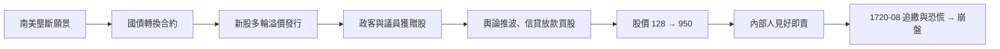
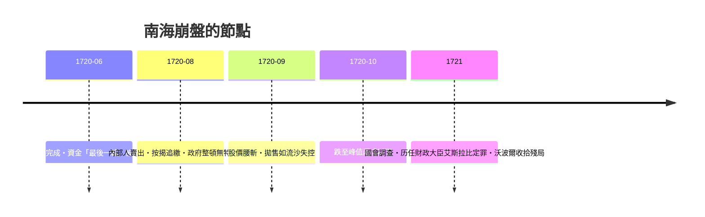

# 第二篇 第五章 第二節：南海泡沫——牛頓算不出的人心

> 1720 年上半年，倫敦。**南海公司（South Sea Company, 1711 年特許）**股價從 1 月約 128 英鎊狂飆至 6 月底峰值約 **950 英鎊**，數月之後崩落至不足兩成。流傳最廣的插曲：**艾薩克·牛頓**（時任皇家鑄幣廠總監）年初賣出持股獲利離場，眼見股價繼續翻倍又再度重倉殺回，最後損失約 2 萬英鎊——「我能計算天體的運行，卻無法計算人類的瘋狂」一語即附會於此（語句出自後人轉述，但其投資受損則大致可信）。

## 一、前因：政府債務與「轉換」交易

1. **1711 年特許**：托利黨政府設立南海公司，把**約 1,000 萬英鎊的政府戰債折換為公司股本**，並授予南美（西屬殖民地）貿易特許——但 1713 年《烏得勒支條約》只給了**有限的非洲奴隸貿易份額**——**實際貿易利潤微小**，公司真正的資產是**政府債權本身**；
2. **1720 年「國債轉換」**：公司向政府提議**承接英國大部分國債**（約 3,000 萬鎊量級）：國債持有人把年金債**換成南海股份**，公司以**溢價新股換取差價、並向政府支付超額利潤**——**整個計畫的成功前提，是股價持續高於換股應價**；
3. **雙泡泡的跨國資金流**：法國密西西比與英國南海共享同一批投資人——**巴黎崩了資金湧向倫敦，倫敦跌了又流回大陸**——**最早的全球聯動泡沫**（見《國家破產的故事》4.1）。

## 二、內幕操作與輿論機器

- **「贈送股」**：公司以**免費認股期權**籠絡關鍵議員與官員——事後國會調查公布的名單震動全國；
- **分期付款買股**：公司允許**部分定金＋分期**——**自帶槓桿的散戶蜂擁入場**；
- **概念股本家**：同期倫敦湧現大量「誇口型」公司（如「以未知方式從鉛提煉銀」的著名謠言小冊）——**「買的是故事不是業務」**，與歷史上所有概念股同構。

## 三、崩盤與審判（1720 秋 – 1721）

- **《泡沫法》（Bubble Act, 1720 年 6 月御准）**被用來打擊小型無特許公司——**資金從小盤抽向南海加速上漲；下半年同一法律令小型公司先崩**，連帶拖垮南海——**監管時點的錯置即是殺手**；
- **審判**：財政大臣**艾斯拉比（John Aislabie）**因收賄被逐出國會；**羅伯特·沃波爾**接手財政並主導債務善後——**沃波爾的「第一首相」地位正由此役奠基**。

## 四、後果

1. **公司法百年緊縮**：此後英國設立公司**必須逐一議會特許**，克制的公司法權長期未開——**企業多退回合伙與家族形態**，直到 1844 年有限公司登記法才修復——**監管矯枉過正本身的代價**；
2. **財經輿論的誕生**：1720 年的小冊與報刊戰（看多派／看空派小冊）——**「金融報導」自此成為產業**；
3. **信用重建的模板**：英政府把南海持股債務**整理為可交易年金**，1750 年代定型的 3% consols（4.2）由此鋪路——**危機後減息＋長期化的重整手法，兩百年後的布雷迪計畫（8 章）組織結構幾乎同款**；
4. **行為金融的第一主打案例**：牛頓的故事成為「**聰明人也逃不過資產價格動態**」的教科書案例——**預期、槓桿、故事、政策時點**四要素在此後每一場泡沫反覆出現。

---

*第六章：華爾街——參見 [6.1 梧桐樹協定](06.1-梧桐樹協定.md)*