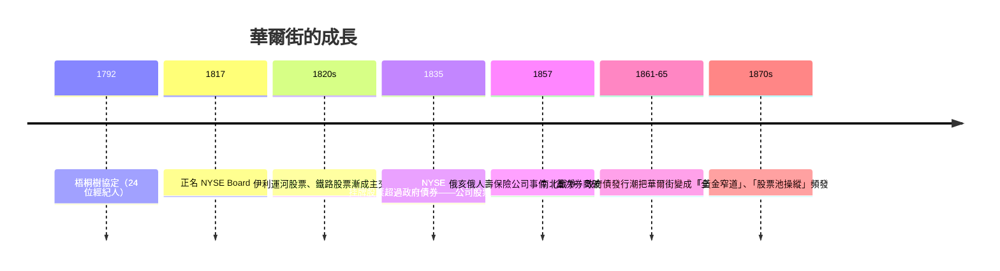

# 第三篇 第六章 第一節：梧桐樹協定——紐約證券交易所的起點

> 1792 年 5 月 17 日，紐約華爾街 68 號附近的一棵梧桐樹（buttonwood）下，二十四位經紀人簽署了一份只有幾條條款的協定：**「我們，締約人，承諾——只用約定最低佣金彼此交易，不讓非締約人插手」**。**梧桐樹協定（Buttonwood Agreement）**表面是「互保」文本，實質上卻是**第一個互助性、排他性的市場俱樂部**——紐約證券交易所（NYSE）的起點。

## 一、前因：想把倫敦搬進新大陸

1. **政治金融**：獨立戰爭後的國債重組（1789–1791 漢密爾頓，詳《國家破產的故事》5.1）造成**聯邦國債與州債市場**；第一銀行（1791，費城）與紐約州銀行相繼成立——**終於有了可交易的公司股票**；
2. **信息環境**：金融報價已見於紐約報紙角落——倫敦的走價單傳統被移植到新大陸；
3. **市場無場地**：初期交易在華爾街與百老匯街口的**咖啡館**（Tontine Coffee House 是其首選）與街頭——**倫敦的「交易巷」是榜樣**，紐約則在城裡隨處成交。

## 二、協定的內涵

**原文概括**（現存抄件）：

```
We, the Subscribers, Brokers for the Purchase and Sale of Public Stock,
do hereby solemnly promise and engage... not to buy or sell... for any
person whatever, for a less Commission than... one quarter of one per Cent.
```

- **最低佣金 0.25%**（原本的佣金競價混亂之中，**建置「價格下限」**）；
- **「只與協定成員交易」**（締約人的**排他性**）；
- **公眾契約性質**——非政府特許，純粹**自我組織的規則**；
- 1817 年組織正式改名「紐約證券交易所（New York Stock & Exchange Board）」，採用倫敦交易所章程為範本。

**紐約交易所的「美國式」特色**：靠**自組織規則**而非國家特許——**「私有俱樂部」**是當時世界交易所的主流模式（荷蘭與英國也如此），美國則將此路徑發揚光大。

## 三、華爾街的雛形：從債券到鐵路股票



**交易品的遷移**是最重要的連續線索：

1. **聯邦國債**（1790s） → **州債與銀行股**（1800s） → **運河、鐵路股票**（1820–50s） → **公用事業與工業股**（19 世紀末）；
2. **創新的「家畜式淪落」**：鐵路建設泡沫（1837、1857 泡沫）、黃金狹路（1869）——**華爾街第一次見識「大槓桿＋大投機的政治經濟學」**。

## 四、後果

1. **合作規則先行、法律第二**：紐交所一路以**自律式管轄**發展，直到 1933-34 年《證券法》與《證券交易法》才由聯邦立法規制——**「私人規則的市場」的美式路徑**；
2. **「金融基礎設施先於監管」的美式路徑**：交易所靠自律而非法律維持秩序——**1817 年的理事會制度**仍是會員俱樂部性質，透明度有限；
3. **文化遺產**：**梧桐樹協定原件（1792）**長期由收藏家所藏、並曾高價拍賣——**它已不只是契約，而是金融「原典手稿」的文化遺產**。

---

*下一節：J.P.摩根——參見 [6.2 J.P.摩根與現代銀行家](06.2-J.P.摩根與現代銀行家.md)*