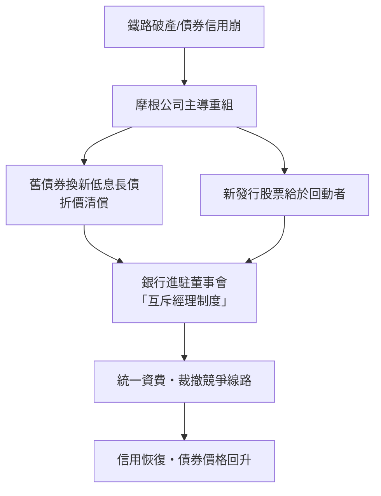
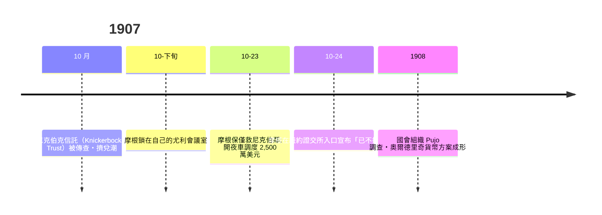

# 第三篇 第六章 第二節：J.P. 摩根與「摩根化」——銀行家作為工業重整者

> 1901 年 3 月，卡內基在紐約交出一張數字：**4.8 億美元**。J.P. 摩根握手成交，把卡內基鋼鐵與多家鋼鐵商合併成**美國鋼鐵（U.S. Steel）**——資本達 **14 億美元**，相當於當時美國聯邦支出一年多的總和。比數字更重要的是方法：**「由一家投資銀行主導產業重組」**——史稱 **Morganization**。老虎機轉子的時代，**投資銀行家決定哪家公司有信用**。

## 一、前因：鐵路時代的資本治理

1. **鐵路建設的資金狂歡**：1870–1900 年，鐵路總里程自 5 萬英里升至 19 萬英里以上，融資依靠**倫敦與歐洲的債券＋紐約的股票**——**投資銀行成為「翻譯者」**：把鐵路故事講給英國保險資本聽；
2. **垮塌與重組的循環**：1873、1884、1893 三波金融恐慌，鐵路公司相繼技術性破產、重組、債券折價交換——**破產管理人的角色由銀行家接手**；
3. **摩根機構的定位**：**「Drexel, Morgan & Co.」承銷鐵路債券並收購股权；債券投資人的「權利保護者」角色**，逼未重組鐵路公司在董事會中**加入債權人代表**——**治理權** 由銀行接管。

## 二、Morganization 的機制

**名場案例**：

- **1869 黃金狹路事件後的鐵路監管**行動；**1887 州際商務委員會成立**——全美第一家鐵路**聯邦監管**機構；
- **破產重組**：**1889 高地鐵路（Highway/Erie 重組）**為「摩根化」標準樣本，**19 世紀 90 年代約 700–1000 條鐵路重組**的制度工程，由數十家投行共同執行；
- **1901 美國鋼鐵**—— 本行第一宗綜躉；即與卡內基的「價格革命」。（卡內基本人散文，寫了《財富》論文：**「死時有錢，是恥辱」**；美元捐贈與大學、圖書館建設）

## 三、1907 年大恐慌：沒有央行的「一夜央行」

- **摩根的操作**：召集各銀行長者，**自己核核、結帳、判定哪家企業有救**——**錢借給哪一家、不救哪一家，由「一個人」決定**；
- **宗教聲譽層**：對**紐約市與州** 的「借條」（以鐵路股做擔保）**與歐洲黃金流動**調度——**「國際資本 24 小時接力」**；
- **代表性結果**：1907 救市方式**無法重複**：不會再有**同一個人＝全美信貸仲裁人**——**催生 1912 Pujo 調查**與 **1913 聯邦準備法**（本書 7.1）。

## 四、後果：三個名詞的誕生

1. **「Money Trust（貨幣托拉斯）」**：**少數銀行家治理全國信貸**的結構性論述，成為**進步派改革（1912 年 W 羅斯福與 W Wilson 競選的核心議題）**；
2. **「經濟審計人」角色的先聲**：**投資銀行對工業股的「品質判言」**使**投資銀行業**成為 20 世紀上半葉的美國金融主軸；其**反效果**——**共同的利盆綁架**，**1933 年 Glass-Steagall**（分離商業銀行與承銷）即以「投行利益衝突」為理由；
3. **「大而不能倒」的第一次社會辯論**：1907–1913 年的揭醜新聞與進步主義政治把「華爾街銀行家救市」塑造成政治問題——「**誰來擔當最後放貸人**」最終以國家機構（聯準會，7.1）作答；

---

*下一節：聯準會——參見 [7.1 聯邦準備法](07.1-聯邦準備法.md)*