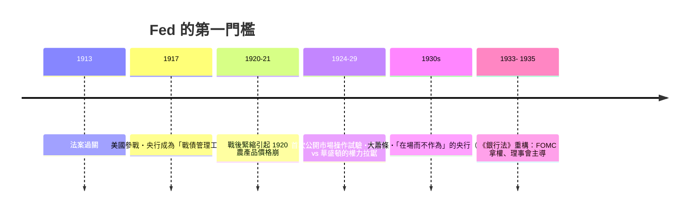

# 第三篇 第七章 第一節：1913 年《聯邦準備法》——一場「民粹 vs 華爾街」十年角力的結果

> 1913 年 12 月 23 日，威爾遜總統簽署《聯邦準備法（Federal Reserve Act）》。美國至此才有**現代意義的中央銀行**——但原來沒有「**一個**央行」，而是 **十二個地區聯邦準備銀行＋華盛頓理事會**的「**存款準備＋發鈔＋商業貼現**」混合體。設計美國央行最難的地方，從來不是技術，而是**政治**：**讓南方與西部農民放心「華爾街不會拿走印鈔機」。**

## 一、前因：四次「沒有央行」的痛苦

1. **第一與第二美國銀行的政治死刑**（1791–1811、1816–1836）：傑克遜總統 1832 年否決延續第二美國銀行——**「央行的敵意」成為美國政黨格局的一部分**；
2. **1837–1907 的「自由銀行時代」**：州準備制度、支票結算延遲、季節性利率 30%＋——**「Payment system 是季節吵架」**；
3. **1907 大恐慌的最終催化**：摩根私人力守（見 6.2）——**「不能指望英雄每輪都到場」**成為兩黨共識；
4. **1908–1913 的制度演練**：**國家貨幣委員會（1908）**、**奧爾德里奇計畫（「國家準備協會」，共和黨版：全國監管央行）** 與**格拉斯-歐文計畫（民主黨版：地區銀行＋政府監管、私有會員權）**——**十年間的美國「央行設計學盛」**。

## 二、制度的複合設計

| 構件 | 設計 | 對應的擔憂 |
|---|---|---|
| 12 區準備銀行 | **地區股東制（會員銀行持股）** | 防「中央壟斷」 |
| 聯準會理事會 | 政府任命、華盛頓監督 | 防「華爾街拿走銀行」 |
| 貼現窗口 | **商業貼現（real bills）為主** | 防投機性放款 |
| 統一發鈔 | **聯準會券（Federal Reserve Note）** | 全國統一紙幣 |
| 黃金準備要求 | **40% 黃金覆蓋（券＋存款）** | 保持金本位體面 |

**「real bills doctrine」**——早期聯準會的理論信條：只貼現「**對應真實貿易**」的短期商業票據——**假設這量與實物經濟需求同調、不會帶來通貨膨脹**——**這在 1929 年後被證明是重災的心理症狀**（7.3）。

## 三、戰間期的演化

1. **「地區平衡 vs 中央權威」的永久拉鋸**：1920s 紐約聯儲總裁**斯特朗（Benjamin Strong）**事實上主導公開市場操作；他 1928 年去世後形成**權力真空**——弗里德曼與施瓦茨把這一「群龍無首」引為 1929–33 危機的體制導火線；
2. **國際責任的成長**：Fed 從「國內貼現機構」逐漸被拉進**金本位國際聯動**——**利率決策第一次有「外交後果」**；
3. **1935 銀行法**：羅斯福體系擡高理事會、設立 FOMC——**今天 Fed 的化構基本在 1935 定案**（7.3 詳述）。

## 四、後果

- **「共和實驗室的央行」**：Fed 的「政府與私人混合構造」成為**各英語國家設央行的教材**；
- **金融治理與黨派政治解耦的艱難**：Fed 成立以後，「**農民負債 → 通膨 仇恨 -> 央行緊縮 → 財富技術**」的民意循環仍在（1977 年 Fed 雙重使命法是後代妥協）；
- **「沒有成為獨立的央行」的反思**，等待 1951（國債管理分離協定）與 1979——Volcker 的『紀律之君』，見 7.2、8 章。

---

*下一節：金本位——參見 [7.2 金本位的榮耀與枷鎖](07.2-金本位的榮耀與枷鎖.md)*