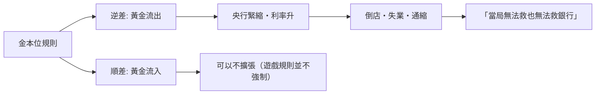

# 第三篇 第七章 第二節：金本位的榮耀與枷鎖——「黃金做的緊身衣」

> 1870–1913年是金本位的「黃金時代」：各主要國家匯率與黃金固定、資本全球化、幣值穩定、貿易蓬勃。但同一件「外衣」有大到緊身的問題——**通貨緊縮的周期、國際收支自動傳導、以及戰爭期間「停兌就逃命」**。1900–1936，**金本位從制度榮光變成危機枷鎖**——每一次試圖「保住黃金」，代價都是**失業與蕭條**。

## 一、金本位的實際運作（真實機制）

| 要素 | 機制 |
|---|---|
| 鑄幣法定地位 | 一國法定**1 單位貨幣 = 固定含金量**（英鎊 1887 後約 7.32 克/鎊，美元 1873 起 20.67 美元/盎司） |
| 自由鑄造、自由兌換 | 公民可自帶金條入造幣廠/央行兌換無限制 |
| 出入口有限傳送 | 匯率被固定在「**黃金輸送點**」之內（約 ±0.6%） |
| 資本與人口自由流動 | 黃金標準對人與資本的流動性依賴極高 |

**「遊戲規則」（Ludwig von Mises 與 Keynes 的自述）**：順差國應寬鬆、逆差國應緊縮——**共同配合使失衡自動收敛**。但「規則」在現實中**是由逆差國「被迫執行」**（順差國可以不停累積）。

## 二、緊身衣的三個標準鬆動

1. **「黃金缺口」與通貨緊縮**：**產出增速 > 黃金供給增速**——物價趨跌、實際負擔由債務人移到債權人——**1890s 美國的「人民黨運動」與布萊恩（W.J. Bryan）1896 年「不把人類釘死在黃金十字架上」的著名演說**均由此而生；
2. **戰時停兌**（1914）：普魯士—英法央行**同步停兌金本位**、發鈔支持戰爭——**「生存時，黃金被丟棄」**；
3. **1920s 回歸**：1925 年財相**邱吉爾力促英國捷回歸金本位**（戰前平價 1 鎊 = 4.86 美元）——此舉使英鎊實質高估、出口受壓、1926 年礦工大罷工——**「逆水匯率」成為大蕭條的前奏**；
4. **1931 英國放棄**（見《國家破產的故事》7.1 之背景）；**1933–34 美國放棄並「提高金價」**（20.67 → 35 美元/盎司）——**「貨幣貶值 41%」的一次性戰略**、隨後工業復甦（信號強度依史學家爭論，但此舉確實釋放通膨預期）。

## 三、黃金制度的「不言目標」

- **非對稱性使本位「緊身衣」**：**擠壓永遠落在逆差國**；順差（如 1920s 的法國，囤積黃金）不會被反向調節——**制度自身的政治不公平**；
- **檢驗這個原則的歷史戲**：**「離開越早、蕭條越輕」**——伯南克、Eichengreen 的經典研究（《金手銬：金本位與大蕭條》）——**在 1931 之後離開金本位的國家更快復甦**。

## 四、後果

1. **「凱因斯批評」成為通路**：1925 邱吉爾回歸時，**凱因斯盼其『別回』**，寫作《The Economic Consequences of Mr. Churchill》——**宏觀經濟學正式成為政策對立面的知識武器**；
2. **戰後設計的直接反命題**：**布雷頓森林（8 章）的金兌換本位**，本質上是**「有出口閥門的金本位」**——既控制黃金缺口、又允適當調整；
3. **文明記憶**：**黃金最容易**「道德化的資本」——1971 以後，**「反法定貨幣」**的文化運動（比特幣 11 章）仍把「**金本位的消滅**」當作其 founding myth。

---

*下一節：大蕭條——參見 [7.3 華爾街股災與大蕭條](07.3-華爾街股災與大蕭條.md)*