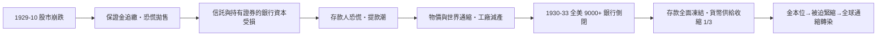

# 第三篇 第七章 第三節：1929 年華爾街股災與大蕭條——金融機制如何改寫政治學

> 1929 年 10 月 24 日（黑色星期四）與 10 月 29 日（黑色星期二），紐約證交所的**股價指數兩週抹掉約三分之一的市值**——1932 年 7 月道瓊指數相對 1929 年峰值下跌**近 90%**。但**股市崩盤不是大蕭條**：真正的殺傷由**銀行系統崩潰＋金本位枷鎖＋全球債務鏈**共同造成——失業率在 1933 年同美國達**約 25%**。1929–1936 的十年，**現代宏觀經濟學、現代證券法、現代存款保險**都被這場災難催生。

## 一、前因：1920s 的三槓桿

1. **散戶槓桿**：**「保證金買股」**——**保證金只要 10%**；經紀人從銀行**拿錢再轉貸給客戶**——**銀行資金進入股市**；
2. **投訴銀行混淆**：各州農行與信託行**證券承銷與存款**混業——**Drexel 等承銷「超級信託」投資貸款在投資領域過量發酵**；
3. **全球資本聯動**：美國修斯對德賠款（Dawes/Young 計畫）的**「貸款-賠款-戰債-利息」的全球資金回合**（參見《國家破產的故事》7.2）。

## 二、崩潰的傳染機制

- **英格蘭 1931 放棄金本位**（參見《國家破產的故事》7.1）；美國 1933 年銀行假與棄金（1934）——**「誰先離開誰復甦」**；
- **中央銀行的失職**：聯儲在 1928–1932 年間**有立場而無作為**（弗里德曼-施瓦茨《美國貨幣史》的著名指控）——**貨幣供給收縮約三分之一**，通縮自我強化；
- **胡佛政府的「放任自由」**——經濟自願合作（企業承諾不降薪）無效，「**胡佛村（Hooverville）**」成為失業的代名詞。

## 三、制度重建

| 法律 | 年份 | 制度 |
|---|---|---|
| 《格拉斯-史提哥爾法》 | 1933 | **商銀/投行分離**、存款利率上限（Reg Q） |
| 聯邦存款保險（FDIC） | 1933 | **史上最大規模的「銀行業社會化補丁」** |
| 《證券法》 | 1933 | **招股說明書強制披露**——證券詐欺的法碼 |
| 《證券交易所法》 | 1934 | **證管會 SEC**、保證金比例管制 |
| 《社會安全法》 | 1935 | 失業保險與養老金—— 對失業的制度保鏢 |
| 聯邦準備法修正 | 1935 | FOMC、理事會收權 |

**「經濟學的思想革命」**：凱因斯《通論》（1936）——「**需方管理**」；**「貨幣幻想」的戰後宏控（IMF、央行公共選擇、政治經濟學系統）**全面興起。

## 四、後果

1. **「金融主權」轉回國家**：羅斯福的「第二次權利法案」（1944 國家資源規劃委員會的「**經濟權利程式**」）——**「國家對經濟機會負責」成為美國政體的一部分**；
2. **國際體系的原始版**：1944 布雷頓森林（8 章）——**全球貨幣秩序重建**在 1929–36 經歷了的「不能與之同步」的「原型測試」；
3. **歷史記憶之巨**：**「1929」成為後世每場金融危機的對照板**——1987、2008（10 章）時，重建荒蕪的再演——**反應模式『現在 vs 1929』**成為所有政策辯論的**參照坐標**。

---

***第四篇：布雷頓森林——參見 [8.1 布雷頓森林的設計](08.1-布雷頓森林的設計.md)***