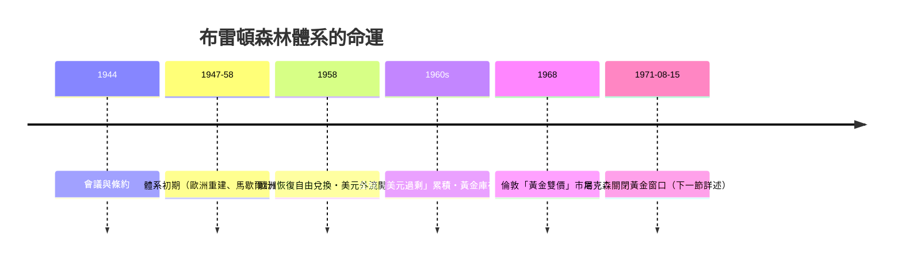

# 第四篇 第八章 第一節：布雷頓森林的設計——兩個知識分子與一種新貨幣秩序

> 1944 年 7 月，新罕布夏州**布雷頓森林**（Bretton Woods）的華盛頓山飯店：44 國代表在此擁擠了三週。兩位主角的矛盾貼在房門上：英國代表**凱因斯（John Maynard Keynes）**——戰後最偉大的經濟學家，受盡肺傷與心臟病之苦；美國代表**懷特（Harry Dexter White）**——財政部文官、出身貧寒、後被發現與蘇聯情報系統有聯繫。他們建立了**世界第一個有制度的全球貨幣體系**：**IMF＋世界銀行＋金兌換美元本位**。

## 一、前因：1930s 的「不能同步」

- **金本位→匯率競貶→貿易崩潰**（1931–33 文獻：見 7.2、7.3）——**「以鄰為塹」的全球縮模式**；
- **資本管制成為常態**：德國的清算協定、英鎊區、美元區——**「金融割據」；
- **三國匯率宣言（Tripartite Agreement, 1936, 英美法）**：匯率變動須事前協商——**「制度化的匯率對話」**是 1944 體系的必要前身。

## 二、凱因斯方案 vs 懷特方案

| 條項 | 凱因斯方案（清算同盟 ICU） | 懷特方案 | 結局 |
|---|---|---|---|
| 清算機構 | 國際清算同盟（bankor 記帳單位） | 國際貨幣基金的常設儲備 | **懷特方案「部分」勝出**：IMF 的 SDR 隻形 1970 才現 |
| 債務權責 | **對稱**：順差國也要承擔擴張責任 | **非對稱**：調整壓力多落在逆差國 | **懷特勝**——美國當時是順差國 |
| 「全球貨幣」 | 引入 bancor 記帳貨幣 | 以美元為中心 | **美元制度化** |
| 懲罰 | 對失衡國徵收利息（含順差者） | 貸款須附條件（conditionality） | **懷特勝**——IMF 條件式貸款成為 8 章主菜 |

**核心妥協——「金兌換美元本位（Gold-Exchange Standard）」**：

$$
1\ \text{盎司黃金} = 35\ \text{美元}; \qquad \text{各國貨幣與美元維持窄幅平價}
$$

- **只有美元兌換黃金**（限央行與政府）；**他國紙幣錨定美元**——**「雙層金本位」**：把「黃金約束」限制在美國，只由美國承擔「兌現責任」；
- **匯率可調整（adjustable peg）**：**基本失衡可重定平價**——**這是「有調整的固定匯率」，非純金本位**。

## 三、制度的雙生子

1. **IMF（國際貨幣基金）**：管理的**國際收支短期失衡**、創造**「黃金+貨幣」兩類床位（quota）**供各國挪融資——投票權按「**份額（quota）**」——**美國一股獨大，重要決策常須 85% 多數（美國一票即可否決）**；
2. **世界銀行（IBRD）**：戰後**重建與發展貸款**——**基礎設施資金化的前身**；
3. **GATT**（1947）作為**後續**：**貿易與貨幣的雙軌建構**——「**貿易自由化 + 汇率管理**」的極端『開放協調體系』。

## 四、後果

- **「美國雙重角色」的死結——特里芬難題（Triffin Dilemma）**：世界需要美元作為儲備，但美元越多、兌換黃金的壓力越大——**矛盾注定失衡**；
- **國家的「共同承諾」**：**IMF 不僅是「救援基金」，而是「全球公言」的地步器**——設定的「**規範**」本身成為後來 1982（8 章）與 1998 東亞危機的管理武器；
- **懷特的蘇聯聯繫成為戰後爭議**：1948 宣誓、1953 逝世——**「知識分子參與制度設計」**與**政治身份的盲點**，成為 1940s 與近代史學爭議的群系。

---

*下一節：芝加哥與期貨——參見 [9.1 金融期貨](09.1-金融期貨的引進.md)*