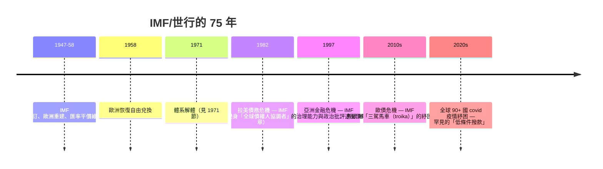
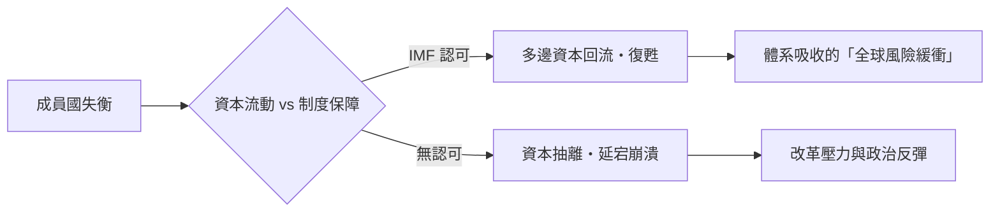

# 第四篇 第八章 第二節：IMF 與世界銀行的運行——全球金融的「公共機構」

> 布雷頓森林創設的兩個機構，在 1944 年時僅是**帳面上存在**（美國國會拖到次年底才批准）。但在 1950s 起的半個世紀中，它們成為**全球資本流動的「準公共法律系統」**：IMF 扮演國際收支急救中心與匯率規則裁判；世界銀行承擔發展貸款的「**排序者**」功能。這一節拆解它們的制度解剖，與其治理權力結構（本節與《國家破產的故事》8.2、12.1 的「IMF 條件式貸款」互為表裡）。

## 一、IMF：三種角色的疊層

1. **監督與結算**：各國按份額（quota）融資、**檢視全球匯率與國際收支政策**；
1. **條件式貸款（conditionality）**：償債危機中的**紓困換改革**（財政、貨幣、私有化等處方；批評與演變詳見 9 章脈絡與《國家破產的故事》8.2）；
3. **SDR 發行**：1969 的**特別提款權**——**不依附黃金／美元的理念性「全球記帳貨幣」**（凱因斯方案的間接實現），但總量很小、不影響日常結算。

## 二、世界銀行：發展融資的制度化

- **1944 設計**是為戰後重建（歐洲），但 **1948 馬歇爾計畫**搶走了重建任務——**世界銀行意外地轉向「發展中國家」**；
- **貸款模型**：**專項項目貸款**（水壩、道路、電力）→ 1980s 的**結構調整貸款**（與 IMF 同類的條件式）→ 21 世紀的**氣候與社會保護**貸款；
- **治理權力**：**總裁由美國提名（慣例），IMF 總裁由歐洲提名（慣例）**——**「美歐共治」的全球金融治理**。

## 三、後果：三個全球化時代的「制度痕」

## 四、須認識的關鍵結構

1. **「條件式貸款」的雙面性**：
   **優點**：**國際承諾可信化**、防「救助因而誘發（moral hazard）」的空間；
   **缺點**：**教條化的緊縮處方**在拉美與亞洲引發嚴重社會後果與政治反彈——2000 年代起 IMF 逐步修正（貧困導向、社會支出保護、資本管制立場軟化）。
2. **「85% 多數」的否決門檻**：**美國持有約 16.5% 份額**——全球治理的重大決策**未經美國同意不能生效**——權力被寫進章程；
3. **世界銀行「發展思想」的漂移**：議程從**基礎設施 → 人力資本 → 治理與制度 → 不平等**逐十年轉移——**每一代的焦點，都反映當時主流經濟學的轉向**。

---

*下一節：尼克森衝擊——參見 [8.3 尼克森衝擊](08.3-尼克森衝擊.md)*