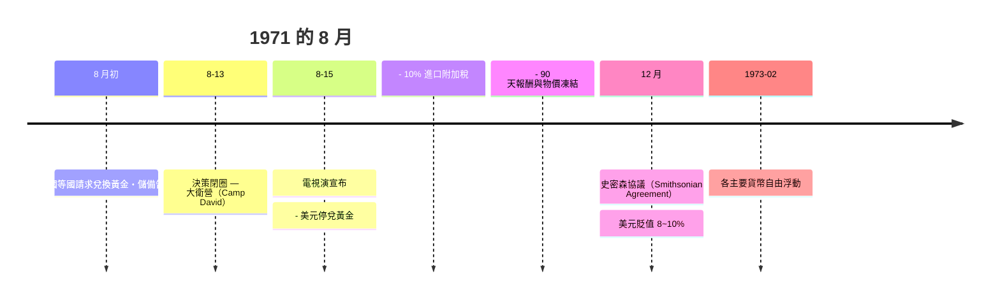
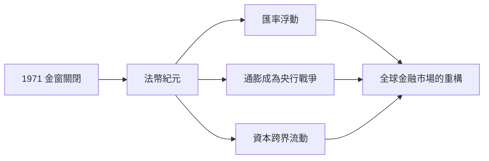

# 第四篇 第八章 第三節：1971 年尼克森衝擊——黃金窗口的關閉與法幣時代的開場

> 1971 年 8 月 13 日（週五）晚，尼克森總統把十餘位幕僚（含財長**康納利 John Connally**、時任國際經濟事務副手與副財長的**沃爾克 Paul Volcker**）關進**大衛營（Camp David）**的一處避暑行館，閉門討論三天。8 月 15 日（週日）晚，他向全國宣布：**關閉「黃金窗口」——美國暫停美元兌換黃金**；同時施以 10% 進口附加稅與 90 天凍薪凍物價。**布雷頓森林體系在此氣數終結。**

## 一、前因：黃金外流的末端螺旋

1. **「美元過剩」的死結（特里芬難題）**：全球對美元作為儲備的需求**不斷增長**，而美國黃金儲備（1950s 約 2 萬噸，1971 銳減到約 8000 噸）**固定不動**——**「承諾總量 > 抵押總量 → 兌現壓力」**；
2. **美國外在失衡**：越戰軍費 + 社會支出（Johnson 時代 "Great Society"）→ 通膨；**1960 年第一次國際美元兌現哄擠**；**1968 倫敦黃金池被擠爆**（黃金雙價市場形成，官方價保持、自由市價一路向上）；
3. **「調整不問政治」的僵局**：美國無論收支失衡如何，**都要增長開支、都難以貨幣緊縮**——**美元信心持續走弱**；法國（戴高樂）**成批用美元換黃金**，英國四面八方請求兌現——**「窗口在 8 月被擠爆」已是時間問題**。

## 二、關窗的具體機制（1971）

- **史密森協議**（1971-12）把此事「制度化」為「**寬幅平價＋美元貶值**」——但**僅一年崩潰**：**1973 年歐洲各主要貨幣沉浮**；
- **沃爾克的角色**：形成「**保護美元、不保護黃金承諾**」的分戰略（他亦提出限定黃金儲備的「關緊救急」概念，預示其 1979 年的 Fed 路線（9 章））；
- **關窗的本質**：**兌換率歸零**——全球儲備標準從此進入「**法幣紀元**」：美國第一次在**沒有黃金承諾**下發行世界主要儲備貨幣；

## 三、後果：三個新時代的生成

1. **匯率體系適時「上岸」**：**1976 年牙買加協議**確認**浮動匯率的合法性**——**匯率成為「市場價格」，各國只需「自由選擇」是否釘**
2. **央行職能的革命**：**沒有黃金枷鎖 → 通膨成為央行的主戰場**——1970s 後期通膨失控，直接催生**沃爾克（Volcker）1979 年的緊縮革命**與 1990s 的「通膨目標制」；
3. **金融化（Financialization）的年表開始**：
   **「無邊界的資本 + 浮動匯率 + 利率自由化」**——**網路金融、對沖基金與衍生品（下一章）**正是在這個「無黃金紀元」中爆發。

**「黃金什麼也沒有失去」的反差**：黃金作為「**資產信仰**」的價格——1971 年 35 美元、1980 年 850 美元、2011 年 1900 美元——**法幣的信任危機恰恰激活黃金二級市場的獲利慾望**：**紀元的終止是「黃金金融化」的開始**。

---

***第九篇：芝加哥衍生品與金融工程——參見 [9.1 金融期貨的引進](09.1-金融期貨的引進.md)***