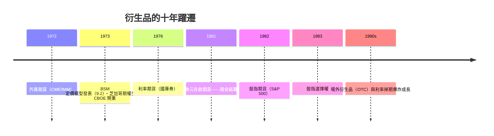

# 第四篇 第九章 第一節：金融期貨的引進——風險第一次成為商品

> 1972 年 5 月 16 日，芝加哥商業交易所（CME）國際貨幣市場（IMM）開張：**七個外匯期貨合約**（英鎊、馬克、日圓、瑞士法郎、加元……）上市。**布雷頓森林固定匯率剛剛死亡三個月**——匯率第一次成為「可以交易的價格」。1976 年利率期貨、1982 年股指期貨——**十年中，「風險」本身被做成了標準化商品**。

## 一、前因：黃金窗口一關，波動率就爆炸

1. **匯率波動的真空**：1971–73 年匯率與利率劇烈浮動——**貿易商、銀行與企業突然「無法鎖定成本」**；
2. **農產品期貨的百年積澱**：芝加哥 1848 年成立**芝加哥交易所（CBOT）**——**穀物遠期→標準化期貨→結算所淨額計算（1883 Chicago Produce Exchange）**——**場內交易+保證金制度+結算所**的模組已經成熟；
3. **「恰好當時的第三人」——利奧·梅拉梅德（Leo Melamed）**：CME 主席、律師出身、大學講師——**一生執念「把 CME 升級為金融商品交易所」**；他借用 **米爾頓·弗里德曼的背書**（1971 年弗里德曼被問「英鎊會跌嗎」，他回答會——這次要他「可以簽名作證」）——**學術權威成為交易所的通行證**。

## 二、合約的設計（真正的新東西）

| 技術 | 內容 |
|---|---|
| 標準化 | 數量（12.5 萬馬克）、品質、交割日、交割地統一 |
| 保證金（margin）+ 每日盯市（mark-to-market） | **盈虧每日結算**——信用風險由結算所吸收 |
| 現金結算（1981 歐元利率期貨首推） | **不須實物交割**——指數可以做「貨」 |
| 雙向交易 | 買、賣都行——**從「避險」變成「表達觀點」** |

**「金融期貨的法律地位鬥爭」**：CFTC（1974 設立）與 SEC 爭商品管轄權——**1982 年 Shad-Johnson 協定**把**股指期貨歸 CFTC、股指選擇權歸 SEC**——**美國衍生品監管的地圖是「兩機構分贓」的結果**。

## 三、後果：金融工程的爆發

1. **「波動率成為資產類別」**：交易員第一次可以**買賣「波動」本身**——**波動率市場**與**對沖基金的 「vol 專家」**由此成形；
2. **「決策的外溢」**：交易所的商品化使**貿易商從「賭徒」轉為「精算師」**——**企業財務學（corporate treasury）作為專業**興起；MBA 的衍生品課**首次成為課綱**；
3. **制度遺產**：**「保證金＋每日盯市＋結算所」**成為所有衍生品市場包括**區塊鏈永續合約（11 章）**的設計藍本。

---

*下一節：Black–Scholes——參見 [9.2 BSM 與選擇權定價](09.2-BSM選擇權定價.md)*