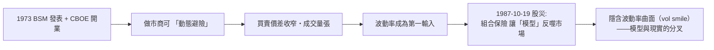

# 第四篇 第九章 第二節：Black–Scholes 與選擇權定價——數學如何為風險「精準標價」

> 1973 年 5–6 月，《政治經濟學雜誌》（JPE）與《金融學雜誌》（Journal of Finance）相隔數週發表了兩篇關於「什麼時候應該為一個『買入的權利』支付多少錢」的論文：**布萊克–斯科爾斯（Black–Scholes）**與**默頓（Robert Merton）**的擴展。它們的答案是一個可以**用五個輸入計算**的封閉式公式。於 1973 年 4 月開業——**公式與交易所同時誕生**；1977 年德州儀器的手持計算器即能求解該公式，交易大廳幾週內幾乎人手一機。

## 一、前因：選擇權定價的百年難題

1. **1900 巴舍利耶（Louis Bachelier）**：史上第一次以**布朗運動**建模股價（《投機理論》——數學上走在愛因斯坦同期之前）——**但無法處理利息與條件約束**；
2. **1960s 的半成品**：斯普林克（Sprenkle）、索普（Edward Thorp《擊敗市場》1967）等人的模型**仍需「預期報酬率」輸入**——**而預期報酬率根本不可觀測**；
3. **布萊克與斯科爾斯的革命**：構造**動態複製組合**（不斷調整持有的股票量去抵消選擇權風險）——**在無套利條件下，預期報酬率被消掉**：**價格只取決於波動率，與人的風險偏好無關**。

## 二、公式（標準形）

$$
C = S_0 N(d_1) - K e^{-rT} N(d_2), \qquad
d_1 = \frac{\ln(S_0/K) + (r + \tfrac{1}{2}\sigma^2)T}{\sigma\sqrt{T}}
$$

**五個輸入**：現價 $S_0$、行權價 $K$、無風險利率 $r$、到期時間 $T$、波動率 $\sigma$。默頓的貢獻：**隨利率與跳躍修正、以連續時間方式證明解的唯一性**（1997 共同獲諾獎；布萊克 1995 年去世未及獲獎）。

## 三、市場的「改寫」與模型的「軟肋」

1. **「delta 對沖 + 投資組合保險（portfolio insurance）」**（Leland-O'Brien 的 1980s 產品）**在 1987 年 10 月 19 日（黑色星期一）的自動賣出螺旋**中被指為加速器——**模型把市場推下懸崖**（一天 22% 跌幅，未有任何基本面事件）；
2. **「隱含波動率微笑（volatility smile）」**：1987 後，**同一標的不同行權價的隱含波動率不再相等**——BSM 的核心假設（常數波動率、無跳躍）**與市場否定**——**量化金融從此以「模型的錯誤」為經常性職業**；
3. **思想遺產**：**「無套利定價」成為現代金融的共同公理**——CDO／信貸衍生品（10 章）與去中心化金融（12 章）的**「完美組合」思維均由 BSM 直接傳承**。

---

*下一節：對沖基金——參見 [9.3 對沖基金](09.3-對沖基金的崛起.md)*