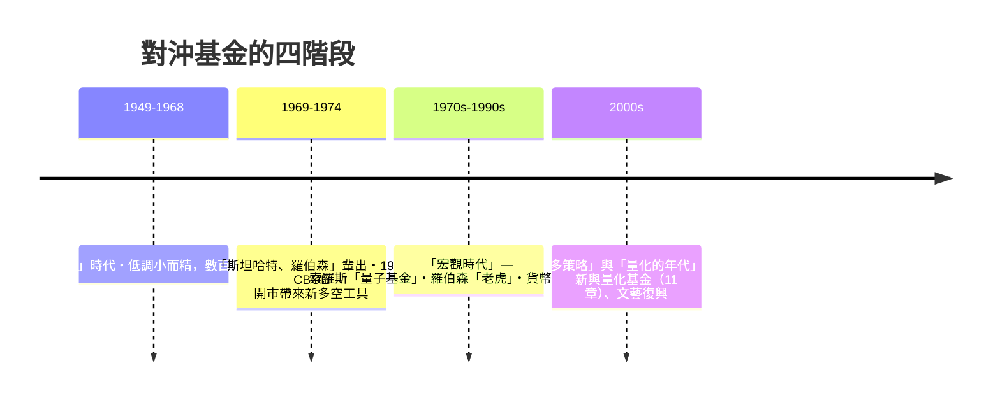

# 第四篇 第九章 第三節：對沖基金的崛起——從索羅斯到「生而為空」的職業

> 1949 年，**阿爾弗雷德·溫斯洛·瓊斯（A. W. Jones）**設立第一個**「對沖基金」（hedged fund）**——有限合夥、績效費 20%、**多空對沖**結構。1950s–60s 少數避險者用它尋求 alpha；到 **1992 年索羅斯做空英鎊**與 **1998 年 LTCM 崩潰**（10 章），對沖基金已成為**全球資本流動與「宏觀觀點」的私人執行力**。

## 一、前因：結構的原始創意

Jones 的四件組裝：

1. **多空同持**（long–short equity）：**做多低估、做空高估**——**市場風險同時被抵消，只留選股收益**；
2. **槓桿**：以投資組合做保，**放大小的統計優勢**；
3. **20% 績效費**：**利益重合**（帶有今天私募的「carry」思想）；
4. **有限合夥結構**：**減少監管透明** —— 1940 Investment Company Act 的豁免。

## 二、四個「職業的階段」

### 1992「黑色星期三」：擊倒英鎊

- **背景**：歐洲匯率機制（ERM）與統一後的德國央行堅持高利率，**英鎊相對過於高估**；
- **索羅斯與德魯肯米勒（Stanley Druckenmiller）**主導的量子基金建立**百億美元級的英鎊空倉**；
- **1992-09-16**：英鎊**被迫退出 ERM**，英國央行升息不奏效——**私人資本第一次「打倒政策機器」**；索羅斯當年獲利約 **10 億美元**——該事件直接促使**全歐「宏觀對沖」的世代成名**（後世稱「**單向大空倉 vs 央行**」的戰鬥戲碼）。

### 制度反應

1. **「多數規則的脆弱」**：**匯率機制本身的不相容（不可能三角，7 章）**——索羅斯的攻擊本質是**制度結構的套利**，非市場哲學；
2. **「對基金的透明化壓力」**：**歐盟 2011 與美國 Dodd-Frank（2010）**要求註冊與申報——**「私人資本必須向公眾文化說明」**，反映 2008 教訓的社會回聲（10 章）；
3. **「Alpha 的供給膨脹」**：1970s 數百人、1990s 數千人、2010s 近萬家——**策略同質化、alpha 變薄**——**量化機構與學院派逐步取代「直覺精英」的世代過渡**（11 章）。

## 三、後果

- **「宏觀對沖」**成為**國際經濟危機的催化劑與「加速器」**（1992 歐、1997 亞、1998 俄）——**私人資本「對賭制度設計」**的描述可以納入國際金融學的教材；
- **「熱錢與政策」之爭**在 1997–98 亞洲危機中達到頂點（馬來西亞 1998 資本管制）——**「資本管制重新被接受」**（參見 8.2 與《國家破產的故事》9.2）；
- **「Barclays pcp 私募」**：**「一個國家可以因為幾千個人的槓桿決策而危機」**——**「全球金融的私化」成為 21 世紀制度議程的標題**（10 章展開）。

---

***第十篇：證券化與雷曼——參見 [10.1 證券化的魔術](10.1-證券化的魔術.md)***