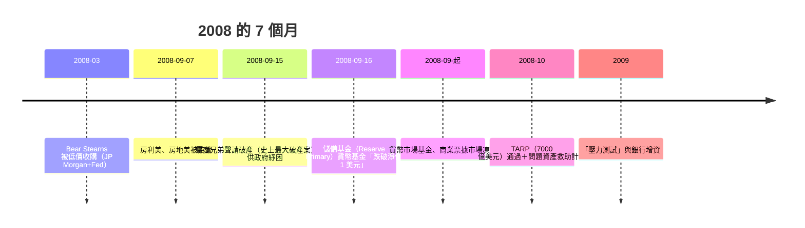

# 第四篇 第十章 第一節：資產證券化的魔術——房貸如何變成 AAA 評級

> 2000–2007 年間，華爾街的加工廠把**次級房貸（subprime mortgages）**切塊、分層、評級、出售——**CDO（擔保債務憑證）**由此而成。**投行的口號是「把風險搬出資產負債表」**；**評級機構的說辭是「分散化降低風險」**。然而，**「正常年景 3% 違約率」的統計，在 2006 年後房價全面下跌的系統性事件中完全失效**——**證券化把風險「藏」起來而非「讓它消失」，最終以更快速度向全球金融系統回流**。

## 一、前因：三個技術政策一起發酵

1. **REMIC 與免稅結構（1986 起）**：證券化基金的法律簡化 → **市場規模化**；
2. **MBS 與「Ginnie/Freddie/Fannie」的先例**：房利美、房地美**聯邦擔保（隱含）**——**「政府支持企業（GSE）」的隱含擔保**成為金融界的信用信仰；
3. **CDO 的數學層疊**（2003 强推「ABS CDO」，直接吸收**次級債券的下層份**）：**AAA 部分由大量「看起來不相關」的次級債打包而來**；**評級機構的收入模型**——給發行人收費——**評級「服務」成為商品化**；
4. **房貸的來源**：**「貸款即資產」**銀行放貸、賣出手——**「沒有置留的風險」**——行為激勵扭曲（**代理問題**：經紀、承押、銀行、投行、評級**五層委託代理**）。

## 二、是什麼讓 AAA 失效

1. **模型層缺陷**：**高斯 Copula**（2000 起普遍）假設**違約相關性可用單一參數**——**危機時「相關性 = 1」使各層同時塌落**；
2. **評級的會計問題**：**AAA 的「本金部分損失」是有條件且難量化**——AA、BBB 的「降級潮」與**評級懸崖**（2007-2008 大批被降級）**令市場突然「不知道該相信誰」**；
3. **CDS 的放大**：**AIG Financial Products** 憑 AAA 的品牌寫出**約 5000 億美元的 CDS 保障**、幾乎不設資本（risk-free 的幻覺）——**「有不需資本保險業」的場外煉金**。

## 三、雷曼的倒下（2008）

- **雷曼的獨特性格**：**美國投行中唯一一家「聯邦不出手、允許破產」**；破產的後果是**貨幣市場基金擠兌、商業票據市場凍結、全球同業拆借利差創紀錄**——「影子銀行」（回購市場、SIV、ABCP 等**不享有存款保險**的體系）在危機時成為**「無央行、無保險」的真空地帶**；
- **TARP 與 QE**：**「問題資產救助計畫（TARP, 7,000 億美元）」**實際轉為**直接注資銀行**；Fed 降息至零與大幅擴表——**「量化寬鬆（QE）」自此成為全球央行的新工具**（詳見 10.2 與 11 章的延續）。

## 四、後果

1. **《多德-法蘭克法》（2010）**: **系統重要性金融機構（SIFI）**、**活 內的縮小（Volcker Rule 禁立場自營）**、**消費金融保護局（CFPB）**——**美國金融史上最大規模的重規制**；
2. **「大到不能倒」的政治經濟學**：**救助既必要又被痛批**——「民粹反彈與自由市場的拉鋸」至今仍主導美國金融政治；
3. **「 Basel III 的資本與流動性新規」**：**資本充足率提高，槓桿上限**——**全球央行「金融監管 ≠ 貨幣政策」首次重大更新**；
4. **「量化寬鬆十年」**——**全球資產價格膨脹、財富不平等**在「**貨幣極端寬鬆**」的微小政局中深化（11 章的 crypto 泡沫、2021 GameStop 等「民間投機」都是延續）。

---

***第五篇：量化交易——參見 [11.1 大獎章基金](11.1-大獎章基金.md)***