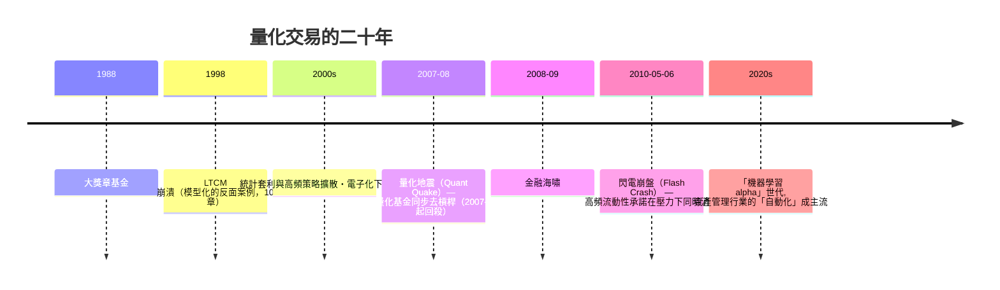

# 第五篇 第十一章 第一節：大獎章基金——數學家佔領華爾街

> 1988 年，石溪（Stony Brook）大學數學系前主任**詹姆斯·西蒙斯（Jim Simons）**創立**文藝復興科技（Renaissance Technologies）**，並於同年推出**大獎章基金（Medallion Fund）**。此後三十年，該基金成為**投資史上報酬率最高且最持久的案例**——**年化毛報酬約 66%**、**費後年化約 39%**、**2008 年全球大跌之年仍盈利 82%**——但它長期**不對外融資，體量小、費用內部化**。

## 一、前因：數學家的勝利路徑

1. **西蒙斯的職業**：**微分幾何**（陳-西蒙斯理論：與陳省生合作的 Chern-Simons invariant）、**冷戰時代的國防通訊專家（IDA）**——**「從事「隱藏訊息」數學的職業自律」為起步條件**；
2. **「從數據到模型」**：與巴菲特、索羅斯的「敘事型投資」逐漸分流，走**「數據型 alpha」路線**——1990s 起**計算資源與數據採集成本的下降**使統計模型第一次可以「在交易時間尺度上」運行；
3. **「數學人才群」**：早期合夥人**鮑姆（Leonard Baum，Baum–Welch 演算法定名者之一）**、**費雷（Robert Frey）**、**勞弗（Henry Laufer）**等——**密碼學與統計人才的商業化**。

## 二、大獎章的機制（根據《The Man Who Solved the Market》與員工證言還原）

| 構件 | 機制 |
|---|---|
| 短期訊號 | 從**期貨、股票、外匯**的**日內與幾天尺度**的統計模式提取信號 |
| 自動化執行 | **演算法執行**（做市商、程序化下單），**「無人性化」記錄** |
| 絕對紀律 | **模型即法律**——人工可以質疑，但**不許手動改倉位**；
| 規模限制 | **總量控制在約百億美元量級**——**「規模是 alpha 的殺手」** |
| 費用結構 | 毛報酬約 66% 年化，內部費率不斷上調（管理費 5%＋績效 44% 量級）——**費後仍約 39%** |

**「為什麼不對外開放」**：**容量有限**——外部資本湧入會攤薄同一訊號的套利空間——**「小」本身就是 alpha**。

## 三、後果：量化時代的制度反應

1. **「2007 年 8 月量化地震（Quant Quake）」**：多家類似的統計套利基金**同時回撤**——**「同一模型」同時清倉**全場、**外溢**成為第一次「算法危機」（量化**流動性理論**由此的「外部性」被建立）；
2. **「高頻交易所（HFT）與閃電崩盤」**：2010-05-06 **道瓊指數在數分鐘內暴跌近 1,000 點後復原**——**算法「以微秒計」為市場提供流動性，但在壓力時「同時消失」**；
3. **文化影響**：大獎章不對外開放，但整個行業學到了其**「模型紀律＋規模節制」**——**「量化基金」與「人類基金」自此成為資管業的兩種文化**。

---

*下一節：高頻交易——參見 [11.2 高頻交易](11.2-高頻交易.md)*