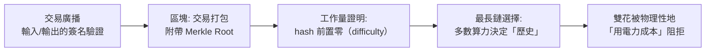

# 第五篇 第十二章 第一節：中本聰白皮書——「雙花問題」的第一次證明解

> 2008 年 10 月 31 日，一篇筆名**中本聰（Satoshi Nakamoto）**的九頁論文《Bitcoin: A Peer-to-Peer Electronic Cash System》出現在密碼學郵件列表。**2009 年 1 月 3 日，創世區塊挖出**——一個**不依賴任何中心機構、任何人都可以驗證的帳本**開始運行。這不是貨幣發明（貨幣與信用早已存在，第一章），而是**「信任的技術化」發明**：**先共識、後交易**。

## 一、前因：密碼朋克的百年拼圖

| 環節 | 先驅 | 年代 |
|---|---|---|
| 對稱/公鑰密碼學 | Diffie–Hellman、RSA | 1976–77 |
| 電子現金 | David Chaum（ecash） | 1983–90 |
| 反「雙花」的去中心化版 | Adam Back 的 Hashcash | 1997 |
| 點對點網路 | BitTorrent、Gnutella | 2000s |
| 疑似未被引用 | Szabo 的 bit gold | 1998–2005 |
| 全球金融的背景 | 2008 危機、雷曼 | 9 章 |

1. **「假名文化的思想資源」**：密碼朋克運動（crypto-anarchy, Eric Hughes《密碼朋克宣言》 1993）——**「隱私是通訊的基本權」**——**比特幣不是從經濟學出發，而是從「通訊權利」出發**；
2. **「電子現金的兩難」**：中央伺服器（Chaum）= 可被政府關；去中心化（b-money、bit gold）= **無法防「同時花兩次（double spending）」**——**這是真正的技術死角**。

## 二、突破：三件套系統

1. **工作量證明（PoW）**：把「**何為有效歷史**」的判斷，改為**「誰付得起電力與硬體」**——**把信任轉化為可計算的成本**；
2. **最長鏈共識**：攻擊者重寫歷史必須**重做全鏈的工作量**——**攻擊成本隨時間呈指數級增長**；
3. **供給上限**：**總量 2,100 萬枚**、每四年產量減半——**「人為的數量稀缺」取代金本位的自然稀缺**（與 7.2 金本位的專題對照）。

## 三、後果：金融史與技術史在同一棟樓裡相會

- **「去中心化信用」**第一次被證明可行——**央行、商業銀行、清算行**的**功能分解**：發行（演算法）、結算（區塊鏈）、保管（密鑰）——**三項基礎職能概念上可以由「數學＋網路」提供**；
- **「雙花問題」解決了鏈上、卻未解決鏈下**：51% 攻擊、交易所中介化、托管被竊——**信任問題從「銀行」轉回「交易所」**（11 章 FTX 的伏筆）；
- **「數字黃金」的重現**：**固定供給上限**接續 19 世紀金本位問題與奧地利學派「反通膨」論證——而創世區塊上寫著**泰晤士報當日頭條**「Chancellor on brink of second bailout for banks」——**誕生日期本身就是對 2008 危機的回應**（參照 7 章金本位的榮耀與枷鎖）；

---

*下一節：以太坊與 DeFi——參見 [12.2 以太坊與智慧合約](12.2-以太坊與智慧合約.md)*