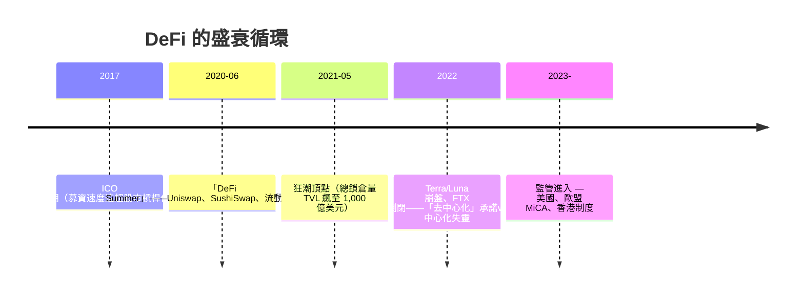

# 第五篇 第十二章 第二節：以太坊與智慧合約——「世界電腦」與金融的重新編程

> 2015 年 7 月 30 日，**以太坊（Ethereum）**主網上線。與比特幣「點對點現金」不同，以太坊的野心是**「世界電腦」**：任何人都可以在區塊鏈上部署**自動執行的程式（智慧合約）**。於是「**發行貨幣**」「**建立交易所**」「**組織借貸**」第一次成為**寫程式的動作**——**去中心化金融（DeFi）**誕生。

## 一、前因：比特幣的「圖靈完備性問題」

- **比特幣腳本語言刻意「非圖靈完備」**——安全但無法複雜邏輯；
- **Vitalik Buterin**（1994 年生，19 歲提出**以太坊白皮書 2013**）：把「鏈」重新定義為**「狀態機（state machine）」**——**每筆交易改變全局狀態、程式代碼決定規則**；
- **2016 DAO 事件**：**「DAO」（去中心化自治組織）募資 1.5 億美元後被**攻擊者用「寫合約的重入漏洞」抽走 360 萬以太幣**——社群以「硬分叉」把歷史倒回，**以太坊分裂為 ETH 與 ETC（以太坊經典）**——**「寫程式即是寫法律；法律有 bug，就只能分叉史觀」**。

## 二、DeFi 的積木（真實運作模式）

| 積木 | 代表協議 | 功能 |
|---|---|---|
| 穩定幣 | USDT/USDC、DAI（算法或抵押） | 與美元掛鉤的「鏈上貨幣」 |
| 去中心化交易所 | Uniswap（AMM 自動做市） | **用公式定價取代訂單簿**（恆乘公式 $x\cdot y=k$） |
| 借貸 | Compound、Aave | 抵押品即時清算——**利率是治理參數** |
| 衍生品 | 永續合約（perp）平台 | **「加密版 CME」**——保證金＋資金費率 |
| 發行 | ICO（2017）→ IDO、NFT | **融資與所有權憑證的鏈上化** |

**「AMM」是一次公式化創新**：Uniswap 用**恆定乘積公式** $x \cdot y = k$ 代替市場撮合——**做市被消滅成為一個數學函數**，人人可成為「流動性提供者（LP）」（但也承擔「無常損失」）。

## 三、DeFi 的產業化與風險堆疊

1. **「可組合性（money lego）」的雙面刃**：協議可以互相疊加（借了錢再抵押再借）——**DeFi 形成無限槓桿的隱形巨獸**（2021 年 5 月的連環強平清算）；
2. **安全成本**：2016–2024 年，**超過百億美元的鏈上被駭與 rug pull**——**「程式即合約」使漏洞即刻兌現**；審計（CertiK 等）成為產業；
3. **監管的落點**：**Howey 測試**套用於代幣——「代幣是否構成證券」仍是全球監管的核心爭議；
4. **制度層走向**：**雙層化**——**「合規的代幣金融」與「公鏈原生實驗」**同系統共存，如同 1602 年 VOC 與同期**黑金走私以至市場共享需求**——金融一直是**中心與去中心化兩個引擎**交替主導（從美第奇、VOC 到以太坊）。

---

**結語過渡**：**「區塊鏈把金融寫成程式」**——下一步，AI 也正把金融的**「決策」寫成演算法**（13 章：生成式 AI 與投資）。

---

***第十三章：生成式 AI 與金融——參見 [13.1 AI 風控](13.1-AI風控.md)***