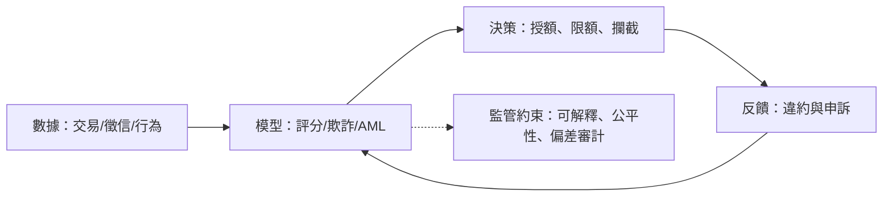

# 第六篇 第十三章 第一節：AI 進入風控——從評分卡到大模型

> 1989 年，**FICO 評分**已統治美國消費信貸；2000s 之後，銀行的**風控模型**從統計回歸走向**機器學習**；2010s **深度學習**進入反欺詐與信用評估；2020s，**大語言模型（LLM）**第一次能「閱讀」財報、合約與新聞——**金融的「判斷」第一次可以外部化給機器**。這是一部**「決策自動化」的六十年史**。

## 一、前因：三個技術時代的疊加

1. **統計時代（1950s–1990s）**：FICO（1956創立）以**邏輯回歸式評分卡**取代信貸員的面談判斷——**「可計算的信用」讓消費信貸規模化**；
2. **機器學習時代（2000s–2010s）**：**反洗錢（AML）**、欺詐檢測、高維特徵——**精度提升，但模型變成「黑箱」**（監管要求可解釋性，催生 SHAP 等工具）；
3. **生成式時代（2020s）**：**LLM 閱讀非結構化資料**（財報、電話會議、監管文件）——**「研報初稿、合約審查、盡調摘要」自動化**——**白領金融勞動第一次被端到端自動化**。

## 二、AI 風控的運行模式

1. **「公平性」的新難題**：模型會**透過代理變數重建受保護屬性**（郵編≈種族）——**美國 ECOA、歐盟 GDPR 與 AI 法案**先後對「自動決策」課予說明義務；
2. **「系統性」的擔憂**：**所有銀行用同類模型 → 同步行為**（2007 量化地震的 AI 版本）——**模型趨同是新的金融穩定議題**；
3. **「審計化」**：**模型風險管理（SR 11-7，2011 美聯儲指導）**成為標配——**「誰為模型的錯負責」**進入董事會議程。

## 三、後果

- **金融業的成本結構改變**：研究、合約、客服、編碼**自動化**——**初級分析師的職業路徑被重建**；
- **「模型治理」成為合規產業**——**審計、紅隊測試、偏差評估**；
- **「決策權」的轉移**：從**信用員 → 統計模型 → 機器學習 → 基礎模型**，**人類的角色從「判斷者」變為「治理者」**——這一主題在 13.2（AI 科學家）、13.3（走向何方）繼續。

---

*下一節：西蒙斯的傳人——參見 [13.2 AI 科學家](13.2-AI科學家.md)*