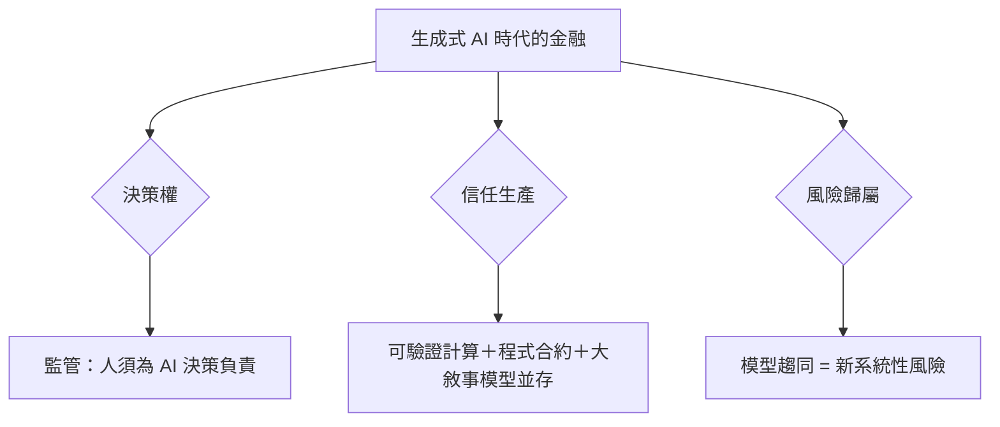

# 第六篇 第十三章 第三節：走向何方——五千年金融史的五條主線

> 從烏魯克的泥板（1.1）到今天的代理模型，金融做了同一件事五千年：**把未來折現、把風險定價、把信任工程化**。本章以五條主線收束全書，並回答設計問題：**金融系統的下一個「制度發明」會是什麼？**

## 一、五條主線（全書的理論骨架）

1. **「記帳先於貨幣」**：烏魯克泥板→複式簿記→中央銀行帳本→區塊鏈——**金融的本體是「共同承認的記錄」**；
2. **「時間的發明」**：利息（漢摩拉比）→ 年金（永續債）→ 期貨/選擇權 → 貼現模型——**金融是不斷擴張的「時間機器」**；
3. **「風險的商品化」**：海上貸款（海事保險）→ 股份公司 → BSM → 證券化 → 鏈上永續合約——**「風險承擔」不斷被切塊出售**；
4. **「信任的成本遞減」**：美第奇的人格信用 → 國家信用 → 央行最後貸款人 → 存款保險 → 算法共識——**每個時代都在降低「相信他人履約」的成本**；
5. **「危機是制度親代」**：英鎊擠兌（南海）→ 1907 → 1929 → 1971 → 2008 → 2022——**每次危機都留下新制度，但沒有一次「解決問題」**——**金融穩定是過程，不是終點**。

## 二、開放的設計問題（AI 時代的金融）

- **決策責任**：**「AI 的判斷，人的責任」**——責任鏈條（教訓：從南海泡沫的動物精神到 LTCM 的盲目相信模型，每次「工具升級」都重演「低估新工具的尾部風險」）；
- **信任的再分散**：**央行貨幣（CBDC）、受監管穩定幣、公鏈原生資產**將長期共存——**「信任市場」的多層化**；
- **人類的位置**：**判斷讓位給機器，治理回歸給人**——**「治理」正是本書從一章到十三章反覆出現的名字**：從泥板旁的印章、威尼斯的長老、阿姆斯特丹的董事會、費城的制憲者、布雷頓森林的代表，到今天的 AI 誠信審計——**金融史就是人類治理「自己創造的力量」的歷史**。

## 三、結語

> **金融的歷史不是「工具的進步史」，而是「信任形式的演變史」**——每當一種新的信任技術（複式簿記、股份公司、央行、區塊鏈、AI）出現，社會都必須回答同一問題：**「誰來擔保它不出錯？」**
>
> 答案從來不是技術本身，而是**制度**。這也是本書的立場：**理解金融，就是理解人類如何組織「未知」**。

---

***全書完***——參閱姊妹篇：《國家破產的故事》《會計的故事》《金融詐欺的故事》《法律設計者的故事》