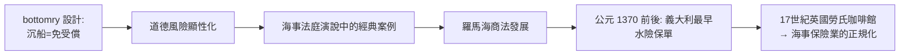

# 第一篇 第一章 第一節：底金借款與沉船計謀——史上第一起記錄在案的海事騙貸

> 約公元前 4 世紀末，希臘東部的開俄斯島（Chios）海域。商人**哈格斯特拉圖斯（Hegestratos）**與合夥人向雅典的貸款人借入「**底金借款（bottomry loan）**」——以船體（bottom of the ship）與貨物抵押的海上貸款——購買糧食。他們的計畫是**鑿穿船底、讓船沉沒**：船沉了就不用還錢，糧食提前轉運私吞，貸款人只剩一片大海。計畫在動手時被船員當場揭穿、倉皇棄船、溺死海中。這是歷史上被文字記錄下來的**最早金融詐欺企圖**，經由法庭演說的引註（如呂西亞斯殘篇與註釋者所引文獻）流傳至今。

## 一、前因：地中海貿易的資金需求與「不沉不還」的設計

古希臘海商貿易（5th–4th 世紀 BC）的制度基礎：

| 制度 | 內容 |
|---|---|
| 底金借款（bottomry） | 波塞冬節慶（如雅典的法定交易日）撮合；**船體＋貨物抵押；船沉則本息一筆勾銷**——利息因此極高（12.5%–30% 常見） |
| 糧食貸款（grain loan） | 專門資助把埃及、黑海的糧食運進雅典的航程 |
| 海事法庭（dikai emporikai） | 雅典專設商業案件法庭，冬季不開庭而快審；審理這類「船沉了誰賠」

**精巧的制度設計，天然地產生道德風險（moral hazard）**：當「船舶毀滅」本身對債務人反而有利，制度就會引導人性中最壞的部分上場。哈格斯特拉圖斯案正是**英國的一句法諺「無人燒自己已保房產」尚未成文之前的第一次反證**。

## 二、案件本身

根據後世流傳的法律殘篇（載於德謨斯提尼誹謗演說集附錄的註釋者所引）：

1. 哈格斯特拉圖斯與合夥人借入大筆款項、設定抵押在船與貨；
2. 船抵達開俄斯島停靠，糧食被移動（後世推測是**暗中轉運**，稀釋抵押品）；
3. 出航後他**計劃鑿沉船隻**、小艇逃走——**這本身就是「假沉船」詐騙技術的最初記載**；
4. 船員發現異常、當場揭穿；哈格斯特拉圖斯跳船逃亡，**溺水身亡**；其合夥人則因缺席審理敗訴，債務要求一律被認定。

## 三、後果與制度遺產

- **「親自防範道德風險」成為保單設計的核心**：後世的船東連帶責任（co－insurance）、免賠額、以及「自我致損不予賠償」條款，本源上都是為了防哈格斯特拉圖斯；
- **海上法庭建立一套「證據法」傳統**——船員證言、撿到的小艇、糧食去向的清查，都是證據規則的雛形；
- **道德風險的制度化預防**，促成後世羅馬法至《拿破崙商法典》與英國 1906 年《海上保險法》一脈相承的「不當致損不予賠償」條款——**條款的靈感首例，就是這則沉船未遂**。

---

*下一節：雅典的海商法庭——古代世界如何把貿易信用變成可執行的制度——參見 [1.2 雅典的海商法庭](01.2-雅典海商法庭.md)*