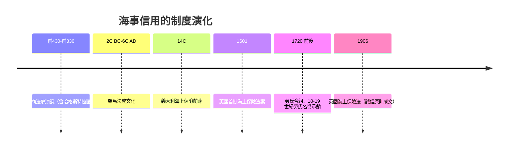

# 第一篇 第一章 第二節：雅典的海商法庭——把貿易信用變成可執行的制度

> 哈格斯特拉圖斯案的價值不在於他死得多難看，而在於**這起案件留下了文字**、被搬進雅典的法庭、並成為後世法學教科書的引例。本節探討雅典為「跨海貿易」打造的一整套**執行信用的機器**——這是人類第一次制度化地、正面迎戰「詐騙」這種經濟行為。

## 一、前因：帝國糧倉的脆弱性

雅典在公元前 5 世紀後發展成一個**自身產糧不足、高度依賴進口**的城市（糧食半數以上來自黑海與埃及）。這造成獨特的政治激勵：

- **糧食貿易被法律特殊化**：雅典立法**嚴懲糧食投機詐欺**——禁止把運往雅典的糧食中途轉售他港、限制糧商每人一次運量、設立糧倉監督官（sitophylakes）；
- **交易季節性**：航海季（約 4–10 月）與法庭季交錯——**雅典專設「海商法庭（dikai emporikai）」**，專審跨海貿易糾紛，並固定在**冬季（約阿提卡曆 9 月至 2 月）開庭**：船隻靠港、商人與證人恰好都在城內，才有條件從速審判；
- **外國商人可訴**：不僅市民，連**外邦人（metics）與同盟城邦商人都可以直接起訴**——這在當時的城邦司法是異數，因為**商業信用必須跨城邦有效**。

## 二、制度設計：三件套

1. **保證金人**：商業訴訟先交押金——**敗訴方承擔，從而把「上訴成本」變成一種「法律上的保險」與詐欺嚇阻**；
2. **演說代筆產業**：呂西阿斯、德謨斯提尼等人代寫法庭演說——**法律專業化的商業化**（現代律師事務所的遠祖）；
3. **公審＋陪審團**：數百人陪審、最輕刑罰罰金、最重充公——**把懾阻公共化**（公民看見者越多，詐欺成本越高）。

## 三、後果：跨海貿易的法律基因

- **羅馬海商法**：羅馬執政官在《埃賽納會議法案》與後續敕令中規範「海商契約」、「海難拋貨」（jettison）分攤——**成為近代海商法的共同起點**；
- **中世紀義大利城市**：阿馬爾菲《海事法規》（Tabula Amalphitana）、比薩《海事法》、羅德島海事法傳說——**都承襲同一精神：把信用執行從「血緣」轉為「制度」**；
- **保險誠信原則（uberrima fides）**：17 世紀倫敦勞氏咖啡館的船舶保險契約，要求**投保者必須主動揭露影響風險的事實**——這一原則可視為對 2600 年前那個鑿船問題的終極法律回答。

## 四、啟示：詐欺與制度是共生演化

- **每一次詐欺，都是一次對制度的壓力測 試**——哈格斯特拉圖斯「測」出的是**抵押品必須由無利害關係者保管**（後來的公證倉儲託管的雛形）；
- **古希臘定義了「合同詐欺（fraud）」與「單純虧損」的區分**：騙子不會消失，因此**制度必須自己長出免疫系統**。

---

*第二章：羅馬元老與兌換商——參見 [2.1 阿金塔里的假帳與假抵押](02.1-假帳與假抵押.md)*