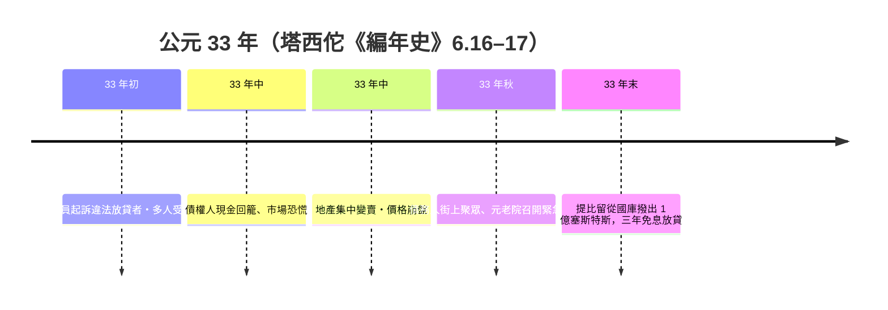

# 第一篇 第二章 第二節：公元 33 年的羅馬信用危機——提比留的「第一次銀行紓困」

> 公元 33 年，羅馬城。一連串的訴訟、利率管制與土地貶值，使整個信貸市場**同時凍結**：債權人追討、債務人變賣地產、地價崩落、更多人破產——**一場典型的「抵押品－流動性死亡螺旋」**。皇帝**提比留（Tiberius）**的解法：動用國庫，向可靠的借款人放出三年免息貸款——史上第一次記錄在案的「**央行式流動性注入**」。

## 一、前因：高利貸的政治週期

羅馬信貸周期向來由「政治→法律→市場」三步驟驅動：

1. **政治動機**：元老與騎士階層大量從事放貸；平民對高利貸的怨恨是**競選動員的永備議題**——司法追訴風險隨宮廷政治氛圍起伏，而非常與經濟基本面同步；
2. **法律觸發**：公元 33 年前後，有關**放貸上限與行省得利比例**的法規收緊（塔西佗《編年史》6.16–17 指認：此時檢察官以「違反利率法」起訴多名元老，其中數人細數破產）；
3. **抵押傳染**：所有貸款幾乎**以羅馬與義大利的土地同時設定抵押**——地價一旦下移，抵押價值、信用額度、成交價全部同步崩落。

## 二、危機的多米諾骨牌

**死亡螺旋**（當代貨幣經濟學的標準圖像，在塔西佗的文本中全數出現）：

- 司法訴訟→資金從借貸市場回籠→**催收（margin call）潮**→土地拋售→**抵押品價值下跌**→更多債務人破產→更恐慌的催收；
- 市場上**「標價」與「買到人」**同時短缺——**老式的「抵押品流動性枯竭」**。

## 三、提比留的紓困：1 億塞斯特斯的「準央行操作」

塔西佗記載的措施（《編年史》6.17）：

1. **國庫（aerarium）直接放貸**：三年免息，向**擁有農地而不超過一定折扣標準的借款人**放貸——相當於現代的「合格抵押品」；
2. **同時的錯誤藥方**：元老院同期**強制把逾 2/3 的資本配置在義大利土地、收回行省貸款**——這一規定**加重**了土地拋售；塔西佗親自指出這條「補救」**反而加劇了崩潰**；
3. **執行順序是成功的關鍵**：以國庫資金托底流動性、放寬償還期限、以兩倍抵押品作擔保——**同時擴大「合格抵押品」名單**，危機於一年內平息。

## 四、後果：三個制度遺產

1. **「最後放貸人」的最早記載**：耶魯經濟史學家的近代論文（如 2010 年前後學者對「公元 33 年」的專文）普遍將此視為**現代央行紓困的古典先例**（比 1826 年英格蘭銀行、Baring 危機早了近 1800 年）；
2. **「善意不當政策」的教訓**：「強制把資本召回祖國」的義務性政策——**資本管制若加重抵押品流向，即是逆火**（現代對應：1997 亞洲「資本撤出潮」中的外匯存底救援）；
3. **政治—金融的共振**：競選口號、司法訴訟、市場崩盤——**金融危機始終是政治事件**（本書第 8 章、第 11 章反覆重現）。

---

*第三章：東方帝國的偽鈔與當鋪——參見 [3.1 交子偽鈔風暴](03.1-交子偽鈔風暴.md)*