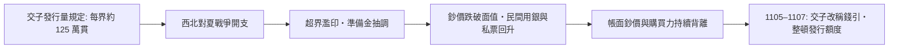

# 第一篇 第三章 第一節：交子偽鈔風暴——紙幣時代的第一次「印鈔權之爭」

> 北宋天聖元年（1023 年），益州（四川）設**交子務**：人類第一批由**政府發行、以鐵錢為準備**的紙幣正式問世。但紙幣是「技術的寵兒，也成了造假的獵物」——**雕版印刷＋雙色套印＋銅印防偽**的博弈，實際上是**朝廷、民間書鋪與偽鈔集團之間數百年的「印鈔權軍備競賽」**，明朝寶鈔則以貶值收場（詳見《國家破產的故事》2.1–2.2）。

## 一、前因：鐵錢之重與「鈔頁之利」

四川行用**鐵錢**：一枚重數兩，**「小錢十貫（萬文）重六十至七十五斤」**——一匹蜀布要挑著幾十斤鐵錢去交易。市場先自發產生解法：

1. **私交子**（10 世紀末起）：成都十六戶富商聯合發行的「存款憑證」，用統一雕版套色印製——**同業信用**；
2. **制度問題**：發行者破產、印版失控、私印氾濫——**景德至天禧年間交子信譽動搖**，訴訟與擠兌頻發；
3. **官交子**（1023–1024）：政府接管發行，**設交子務、定界（三年一界）、定準備金（本錢 36 萬貫）**。

**同時**，紙鈔的「技術濃度」前所未有：

| 防偽手段 | 來源 |
|---|---|
| 精細雕版＋套色 | 川蜀雕版印刷中心成都 |
| 桑皮紙、楮皮紙等長纖維紙 | 川蜀造紙供給充足，易驗質地 |
| 題字與花押號 | 每一界印行皆有編號 |
| **官方嚴禁＋死刑** | 「偽造交子者處磔刑」 |

## 二、偽鈔的三種競爭路徑

1. **標準「技術詐欺」**：私刻印版、偽造官印——**《宋史》記載處決偽鈔犯的案例屢見不鮮**——這是「有死刑嚇阻也壓不下去的犯罪」；
2. **內部夥同造假**：印鈔局的匠人與經手官吏「私印、調包、以廢票換新票」——這類刑案在會子與寶鈔時代的文書中屢見不鮮；
3. **「合法版偽鈔」**：官府因財政緊急而超界加印——**發行者自己成為貨幣品質的破壞者**。

## 三、崩潰的動態：不是「假鈔太多」，而是「真鈔印太多」

- 北宋末「**錢引**」繼起：宋徽宗時期濫發至數億貫、價值腰斬——**「真鈔的超發」比「假鈔的偽造」更致命**；
- 南宋的「**會子**」續演此賽局：**嚴禁民間覆刻印鈔**、設**進呈房辨鈔**驗鈔、以**兌鋪（金銀交引鋪）**做二級信用——仍止不住貶值；明朝寶鈔索性以「**不許不收者行杖**」的法律強制流通以維持名義（與明朝寶鈔同樣結局：以強制力餵養贬值）。

## 四、後果：三條制度謎題

1. **發行權的壟斷＋強制收兌**：北宋的教訓是「**官方發行權不等於信用**」——相同邏輯在 6.1 威瑪、8.2 IMF 時代重複出現；
2. **防偽目的是「可驗」，而不是「不可仿」**：後世鈔票的**水印、多功能花邊雕紋、簽名花押**——都是「**增加造假成本而非消除**」的設計思路；
3. **金融信用的根本是「發行者的節制」**：這一規律將在 4 章（約翰·勞）、6 章（威瑪）與 11 章（Libra／穩定幣）反覆驗證。

---

*下一節：明清典當業的「虛包詐貸」——參見 [3.2 虛包詐貸](03.2-虛包詐貸.md)*