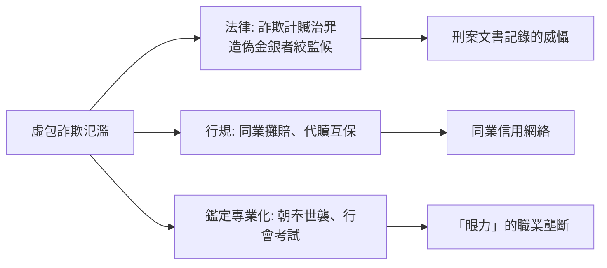

# 第一篇 第三章 第二節：明清典當業的「虛包詐貸」——用鉛塊與假珠寶榨取銀兩

> 「**虛包**」——清代刑科題本與地方司法文書中的專有名詞：**以鉛塊灌銀、以錫珠充珍珠、以玻璃冒翡翠**，把假貨抵押進當鋪或銀號，借走真白銀。明清長達五六百年的典當業，發展出了這個時代最精緻的「**抵押品詐欺產業鏈**」。

## 一、前因：當鋪的運作與「驗當」的極限

典當行（質庫、解鋪、當鋪）的商業模型：

| 環節 | 內容 |
|---|---|
| 收當 | 現場估價（衣服首飾、器物）→ 折價（常為五至七成）→ 開票 |
| 保管 | 密室庫房＋按月計息（月利 2–3% 常見，法律強制上限「**三分息**」） |
| 贖當 | 到期不贖即「**當**」（沒收變賣） |

**詐欺空間來自三個結構性弱點**：

1. **鑑定靠眼力**：驗當師傅（朝奉）個人經驗判斷——**沒有成分檢測**；
2. **當票不寫細節**：法律慣例当票上「**蟲吃鼠咬、光板沒毛**」等模糊用語＋**故意把真珠寶寫成低俗品名**（防止爭議時抬價，同時也方便行內識別）；
3. **折價即緩衝**：五成折價本意是吸收估價風險——但**詐欺者的成本更低**（鉛塊成本近乎零）。

## 二、虛包詐欺的技術與組織

刑案文書呈現的完整產業鏈：

1. **製假**：鉛塊灌銀（外面鍍一層真銀）、錫珠冒充珍珠、玻璃充寶石、銅器鎏金；
2. **銷贓式放貸**：**「打當」組織**——同一批假貨在多家當鋪輪番抵押，或結夥在同一天到多家鋪子出當（擴大單店判斷資訊的孤島性）；
3. **內外勾結**：贿赂朝奉驗假為真——**「與驗當人合夥」是 最難破的形態**；
4. **事後兌現**：到期**棄當**（不贖），當鋪砸開「銀錠」時才發現是鉛。

**著名的宏觀事件「州當舖整體被詐」型紀錄**（如乾隆、嘉慶年間直隸、山東諸案的題本）顯示：**單一家當鋪被詐的損失動輒上千兩銀，足以令小店破產**——這是「**抵押品信任體系的系統性攻擊**」。

## 三、制度的應對

- **法律**：明清律「**詐欺取財**」條計贓論罪、偽造金銀者重罪（乾隆年間鑄偽銀案多判絞候）——但**刑事追訴趕不上組織化詐欺的速度**；
- **行會制度**：當鋪行會**設立「識當」通報制度**——一家鋪發現假貨，**通報同城同行、登記特徵**（早期「黑名單資料庫」）；行會「**攤賠**」分擔損失——**風險共擔的制度創新**；
- **鑑定職業化**：朝奉的「眼力」以師徒制度傳承，驗金用「**咬試」「煎試**」（熔點、色澤）——**前科學時代的材料檢測**。

## 四、後果：三條延伸線

1. **「抵押品驗證」成為職業**：鑑定師、公證倉儲、第三方檢測——**今天的黃金檢測中心與珠寶 GIA 證書，是「朝奉」的現代後裔**；
2. **古代詐欺的「組織化」特徵**：虛包案件已呈現**分工、跨店、跨區**的現代詐欺結構——預示本書第 7 章（沙拉油）、第 9 章（麥道夫）的組織複雜度遞增；
3. **當票語言的「防詐函數」**：「蟲吃鼠咬」的模糊表述，本質是**雙向詐欺防禦**（既防客人造假也防鋪戶賴帳）——**合同語言是博弈均衡**。

---

## 銜接提示

同一時代的歐洲，同樣的「**假抵押 + 假帳**」遊戲以更大規模上演——不過主角換成了**國王自己的金融實驗**：下一章看約翰·勞如何用一整套「合法的紙上黃金」把法國推入史上最著名的泡沫。

---

*第四章：約翰·勞與南海的紙牌屋——參見 [4.1 約翰·勞的紙鈔煉金術](04.1-約翰勞的紙鈔煉金術.md)*