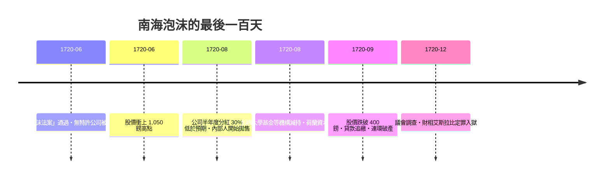

# 第二篇 第四章 第二節：南海公司與牛頓——「官方背書」的泡沫結構

> 1720 年的倫敦，**南海公司（South Sea Company）**用「**接收國債＋股價上漲**」的循環，把整個英國政商界捲入——**國王是總督、議員收賄、皇家造幣廠廠長牛頓（Isaac Newton）虧損兩萬英鎊**，並留下那句（可能被後世潤飾的）名言：「**我能計算天體的運行，卻無法計算人類的瘋狂**」。這一節拆解：**為什麼「有真實特許權、有官方背書」的公司，反而製造了更完美的詐欺結構**。

## 一、南海公司的「真實業務」與「想像業務」

| 層次 | 內容 | 真實性 |
|---|---|---|
| 特許業務 | 壟斷南美洲（西班牙屬地）奴隸貿易與通商 | **真，但幾乎不賺錢**——西班牙每年只准一艘船，戰爭時還中斷 |
| 財務業務 | 1711 年起承接政府年金（兌換國債換股份） | **真，這是主要利潤來源** |
| 泡沫業務 | 1720 年「債轉股」計畫：把 3,100 萬鎊國債全數轉為公司股票 | **結構是真的，收益假設是假的** |

1. **「債轉股」的機制**：公司向持券人提出「用國債換新發行的股票」——**國家每年少付利息、公司賺「差價」、持券人賺「股價上漲」**——三方的算術在**股價不斷上漲**的前提下才成立；
2. **「自我實現」的迴路**：公司憑「未來轉換收益」發新股 → 賣股所得借給股東買股 → **股價漲 → 更多持券人轉換**——**這就是現代「龐氏循環」的公司版**（參見第 6 章龐氏、第 11 章 FTX）；
3. **「官方背書」的放大器**：國王任總督、議會多數議員收了**「選項股」（認股權賄賂）**——**國家機器成為泡沫的推銷員**，這是它比荷蘭鬱金香（3.3）更「現代」之處。

## 二、崩潰的順序（1720 年 6–9 月）

1. **「泡沫法案」的反效果**：取締無特許公司，本意是保護南海——**投資人卻發現「特許股也是同類」**，信心反轉；
2. **「冬季分紅」的破功**：8 月宣佈的 30% 分紅**低於市場期待的 50%**——**數字第一次誠實，市場第一次恐慌**；
3. **「牛頓的兩次進出」**：早期獲利了結（約賺 7,000 鎊）→ 看到鄰居繼續暴富後**高點追回、最後虧損約 20,000 鎊**——**「聰明人也會二次入場」**是行為金融學的教科書案例。

## 三、崩潰之後：詐欺責任的第一次「制度處理」

1. **「議會調查」與「財政大臣入獄」**：艾斯拉比（John Aislabie）因收受選項股被判**「犯重罪、逐出議會、沒入倫敦塔」**——**「內線利益」第一次成為刑事問題**；
2. **「沃波爾的收拾」**（Robert Walpole）：把公司股債重組（**「東方債券式」的強制攤提**）、保住特許權——**沃波爾由此成為「實質第一任首相」**（見《金融的故事》5.2）；
3. **「牛頓與損失會計」**：據其姪女婿記載，牛頓拒絕再談此事——**「皇家科學的信用」與「個人投資的愚蠢」並存**，成為後世**「專家陷阱」**敘事的源頭；
4. **「立法的長陰影」**：泡沫法案使**英國公司設立凍結近百年**（直到 1825 年廢止）——**一次詐欺，讓「公司法」倒退一個世紀**——**詐欺的成本由「未來的創業者」支付**（與第 9 章 2002 年沙賓法案、第 11 章 FTX 後的監管收緊同一劇本）。

## 四、後果：從泡沫到「詐欺學」的三個遺產

- **「官方背書 ≠ 真實性」**：**「國家與特許權」被詐欺者反覆借用作信用**——交子（3.1）、密西西比（4.1）、南海、乃至後世的「國企概念」（第 10 章世通與第 12 章 Terra 都以「制度級信用」為行銷）；
- **「數學天才也會破產」**：牛頓、以及兩百年後的 LTCM 諾獎得主（見《金融的故事》9.3）——**「模型與瘋狂」是金融詐欺史上最穩定的搭檔**；
- **「調查—定罪—重組」的制度模板**：南海案的**議會調查＋財相入獄＋債務重組**成為此後兩百年**大型金融詐欺的「國家反應標準流程」**。

---

*下一章：1790 年代的杜爾投機與土地詐欺——參見 [5.1 杜爾投機案](05.1-杜爾投機案.md)*