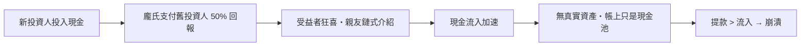

# 第五篇 第七章 第一節：龐氏騙局——「用後來者的本金，支付先來者的利息」

> 1920 年，波士頓。義大利移民**查爾斯·龐氏（Charles Ponzi）**宣布一個「無風險套利」：**國際回郵券（IRC）**——利用各國郵資匯率差，在西班牙低價買回郵券、在美國高價兌換。數學上這確實存在，**但規模小到根本裝不下他的資金**。九個月內他吸收了**數萬人、約 1,500 萬美元**；7 月《波士頓郵報》揭穿，8 月破產、入獄——**「龐氏騙局（Ponzi scheme）」從此成為金融詐欺的通用名詞**。它的本質：**不投資任何東西，用後來者的本金支付先來者的「報酬」**。

## 一、前因：龐氏的「機會主義鏈條」

1. **前科累累**：龐氏早年因偽造與偷渡官司入獄（加拿大、美國）——**「職業詐欺者」的履歷被波士頓公眾無視**；
2. **「套利故事」的真實內核**：一戰後匯率紊亂，IRC 匯率確實滯後——**龐氏的「故事」有 5% 的真實**——**所有龐氏騙局都需要一個可講述的「合理生意」**（對照第 9 章麥道夫的「期權對沖策略」）；
3. **「90 天 50%」的報價**：**每 45 天 50%、90 天翻倍**——與當時銀行存款 5% 年息的差距大到**無人追問機制**——**「報酬高到不好意思問」是所有龐氏案的共同破綻**。

## 二、機器如何運轉

1. **「紙上帳目」**：龐氏的「證券兌換公司（Securities Exchange Company）」**沒有投資帳本**——只有現金流水——**事後審計發現「帳務不存在」**；
2. **「媒體的雙刃」**：《波士頓郵報》記者巴倫（Richard Barr）持續追查——**龐氏反訴誹謗、被民眾當英雄**——**媒體揭露在狂熱期幾乎無效**；
3. **「數學的必然」**：以 50% 半回報率，**維持一年需要的資金呈指數爆炸**——**龐氏案的壽命上限由算術決定，不由警察決定**（麥道夫能撐三十年，正因他把「報酬」壓到 10–12%，像真的）。

## 三、崩潰與審判

- **1920-07**：《郵報》頭版揭露 IRC 數量根本支撐不了他的規模（全美流通的 IRC 不足以兌換其承諾額的零頭）；
- **1920-08**：擠兌三日內歸零——**龐氏自首**；聯邦與州分別起訴（他試圖「先服一邊刑期」），前後入獄多次，1949 年窮死於里約熱內盧；
- **「代人受過」與「真正逃脫者」**：其關係人（如前合夥人與某銀行家）有人逃亡海外——**龐氏案的「主犯只有一人」是罕見例外**，大型金字塔案通常有「沉默的搭檔」。

## 四、後果：一個「可複製的模板」

1. **「龐氏騙局」成為分析工具**：此後所有「支付舊戶、吸納新戶」的結構都以此命名——**1970s 的連鎖信、2000s 的馬多夫（第 9 章）、2022 年 Terra/Anchor 的 20% 存息（第 12 章）**；
2. **證券監管的催化**：美國各州藍天法之外，**聯邦《1933/1934 證券法》的「披露哲學」**部分正是對「無帳本、無資產、只有現金池」的直接回應（見《法律設計者的故事》證券法章）；
3. **「審計的底線」**：龐氏案確立了一條此後反覆驗證的準則——**「先問錢放在哪，再問報酬從哪來」**；無法回答第一問的，就是龐氏結構。

---

*下一節：1963 年的沙拉油醜聞——參見 [7.2 沙拉油醜聞](07.2-沙拉油醜聞.md)*