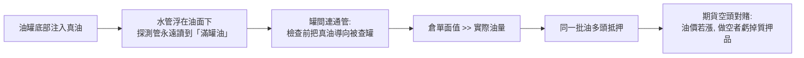

# 第五篇 第七章 第二節：沙拉油醜聞——「同一桶油，抵押了無數次」

> 1963 年 11 月，新澤西。**美國運通（American Express）**的倉庫子公司簽發了**價值約 6,000 萬美元、以「沙拉油」為標的的倉單**。稽查員打開油罐：**大部分是水，只在檢測管能探到的底部灌了一層油**——**「底部加油」（同時連通管道讓油在罐間流動應付檢查）**。持有這些倉單的 51 家經紀商中 19 家倒閉，**美國運通股價腰斬**——而華倫·巴菲特以此案寫下**「品牌比倉庫值錢」**的著名投資判斷。主謀**迪安吉利斯（Anthony "Tino" De Angelis）**用這些倉單反覆質押融資——**「重複質押」從此成為商品詐欺的教科書詞彙**。

## 一、前因：一個「前科供應商」的生意

1. **蒂諾的履歷**：前紐約證交所成員、1950 年代曾因**向學校午餐計畫詐欺供應變質肉**被逐出交易所——**被大市場除名的人，轉身做大宗商品的供應鏈**；
2. **「政府補貼套利」**：他的 Allied Crude Supply 賺的是**歐洲「食物換和平」計畫**的植物油出口補貼——**補貼額高到讓「油的真假」變成次要問題**；
3. **「倉單融資」的結構**：銀行與經紀商**按倉單面值貸款給他**；他又把**同一批倉單向多方抵押**——**沒有中央登記、沒有實地盤點**。

## 二、機制：如何讓水冒充油

1. **「信息中介失職」**：美國運通的倉庫子公司**驗收不盤點、憑對方提供的單據開倉單**——**「品牌的信用」被員工的怠惰透支**；
2. **「期貨市場的放大」**：迪安吉利斯在交易所**大量做空油類期貨對賭自己的質押倉單**——油價暴跌後，**交易所以「他拿不出實油」為由拒絕其履約**，連鎖把 19 家經紀商拖倒；
3. **「行政查核的偶然」**：崩盤導火線是**一次例行的銀行貸款複查**發現罐群接水量異常——**重複質押幾乎總是被「無關的例行檢查」引爆**（對照第 10 章 Wirecard 的兩行缺席銀行餘額確認）。

## 三、後果

1. **「倉單經濟」的重建**：交易所與銀行界建立**獨立第三方倉儲＋定期突擊盤點＋倉單唯一登記**——**今日商品期貨的交割倉制度直接源於此案**；
2. **美國運通的「品牌估值」**：巴菲特以**倉庫子公司僅佔集團小部分、而品牌毀損被過度計價**為由，**重倉買入約 40% 資產的美國運通**——**詐欺事件第一次成為價值投資的著名買點**——但注意：他的判斷成立，是因為**受害的是子公司而非客戶資金**（麥道夫案的客戶沒有這種運氣，第 9 章）；
3. **「重複質押」的長陰影**：同一結構在 2008 年以**「同一批房貸質押給多層 CDO」**復活（見《金融的故事》10.1）——**「一物多押」是金融詐欺史上唯一跨四百年不死的機制**（從 17 世紀的假抵押，到 1963 的油，到 2022 年 FTX 客戶資產被挪用）。

---

*下一章：1970–80 年代的羅伯特·維斯科與「伊朗門」金融——參見 [8.1 維斯科案](08.1-維斯科案.md)*