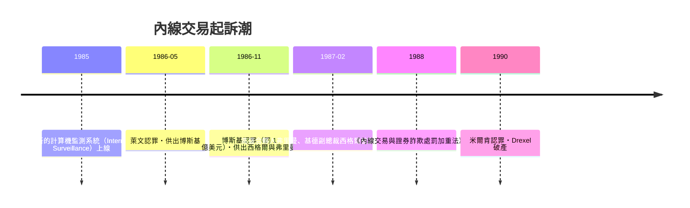

# 第七篇 第九章 第一節：內線交易的法律誕生——從「習慣」到「重罪」

> 1980 年代，**伊萬·博斯基（Ivan Boesky）**靠著**並購消息提前買股**賺進數億美元、在伯克利畢業典禮上說「**貪婪是健康的（greed is all right）**」；**丹尼斯·萊文（Dennis Levine）**在德崇（Drexel）的頂樓辦公室用瑞士帳戶交易；**麥可·米爾肯**的高收益債機器為他們提供彈藥。1986–87 年，**記者、證交所監測、檢察官魯道夫·朱利安尼**合力引爆**華爾街史上最大內線交易網的起訴潮**。本節拆解：**「用別人還不知道的信息交易」是如何在法律上被發明出來的**。

## 一、前因：法律的「借屍還魂」

1. **1934 年證券交易法 §10(b) 與 SEC 規則 10b-5**：一條**「反操縱」的概括條款**——**原文根本沒有「內線交易」四個字**；
2. **1968 年 Texas Gulf Sulphur 案**：二審法院第一次宣佈**「知悉重大未公開信息者不得交易」**——**法律是判例「讀出來」的**；
3. **1980 年 Chiarella 案**：最高法院劃出**「受託關係」的界限**——**「只是偷看」不犯法，「背叛受託義務」才犯法**——**這迫使 1980 年代的起訴潮必須證明「信息鏈的忠誠斷裂」**。

## 二、1986–87：網絡的爆破

1. **「數據監測」的問世**：**異常成交前於公告**的模式識別——**「監管第一次擁有計算機」**（與今日的算法監測、12 章的鏈上分析同一譜系）；
2. **「減刑換供詞」**：萊文→博斯基→西格爾的**「階梯式認罪協商」**——**詐欺網絡的執法依賴「內部人競相自保」**；
3. **《1988 處罰加重法》**：罰三倍所得＋行政追訴（1990s 的行政和解）——**內線交易從「灰色職業」變成「高風險職業」**。

## 三、後果

- **「受託義務」成為證券法的中樞**：**「誰欠誰忠誠」**決定一切——這條線直接通向現代**「信息不對稱治理」**的整個框架（《法律設計者的故事》證券章）；
- **「貪婪年代的敘事」**：博斯基的演講、1987 年電影《華爾街》的 Gekko——**詐欺第一次成為流行文化的道德劇**；
- **未解的餘波**：**內線交易的執法至今仍是「選擇性」的**——1987 年的網絡只抓到最招搖的一層；**「並購前的大量異動」直到今天仍是 SEC 大數據部門的日常**（對照 2020s 的國會議員交易爭議——法律的邊界仍在辯論）。

---

*下一節：麥道夫——參見 [9.2 麥道夫的六百億美元幻覺](09.2-麥道夫的六百億美元幻覺.md)*