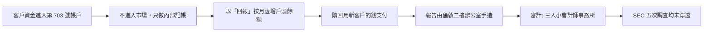

# 第七篇 第九章 第二節：麥道夫的六百億美元幻覺——「不可能的穩定」如何騙過所有人

> 2008 年 12 月 11 日，金融海嘯中期，**伯尼·麥道夫（Bernie Madoff）**向兩個兒子承認：**「一切都是一個大謊言」**。他被捕後查明：**約 650 億美元的帳面資產、跨越三十年的「穩定 10–12% 回報」**——**從未發生過任何一筆真實交易**。這是史上最大的投資詐欺（金額），也是**最依賴「社交信任」的詐欺**：受害者包括猶太慈善基金、歐洲私人銀行、名校基金會與他自己的家人。本節拆解：**為什麼「沒有交易」反而最難被揭穿**。

## 一、前因：三層信用的疊加

1. **「市場基建者的光環」**：麥道夫是**NASDAQ 前主席**、電子撮合與場外交易的先驅——**「他本人就是交易所的臉」**（對照 4.2 南海的官方特許、8.1 維斯科的職業光環）；
2. **「猶太社群的封閉網絡」**：以鄉村俱樂部、慈善晚宴為渠道——**「不公開募資」反而是吸引力**——**「排他性」成為行銷**；
3. **「split-strike 轉換策略」的障眼法**：宣稱**買藍籌股＋賣出價外買權**——策略足以「解釋」平滑回報，**但從未執行**——**「聽起來像真的」比「看起來像真的」更重要**。

## 二、機器：為什麼三十年無人戳穿

1. **「託管分離」的缺失**：客戶資產**託管在他自己的公司**——**「經理人＝託管人＝經紀商」三位一體**——**這是所有資產挪用案的結構性前提**（FTX 同構，第 12 章）；
2. **「審計的笑話」**：出具意見的是**郊區三人小所（Friehling & Horowitz）**——**該所甚至不參加同業複查**——而**數十億美元級的歐洲銀行「盡調」竟也接受了它**（Wirecard 的 Ernst & Young 對照，第 10 章）；
3. **「吹哨人的十年孤戰」**：**馬可波羅斯（Harry Markopolos）**1999 年起五度向 SEC 舉報、寫出完整數學反證（**「他所宣稱的策略在統計上不可能」**）——SEC 均未立案——**「不可能的太平滑」是最好的量化紅旗**，卻敵不過**「光環 + 不查」**；
4. **「信徒的社會學」**：**受益者不敢查**——查了可能被踢出「俱樂部」——**受害者是詐欺的共謀者（心理層面）**，這是金字塔案的永恆動力。

## 三、崩潰與清算

- **觸發器**：2008 贖回潮（客戶需要現金）+ 麥道夫**無法籌到新錢**——**龐氏結構死於「流入 < 流出」**（與 1920 龐氏同一死因，第 7 章）；
- **判決**：150 年刑期；兒子馬克 2010 年自殺；妻子被追繳至剩餘 250 萬美元；
- **清算機制**：**SIPC＋受託人皮卡德（Irving Picard）**以**「現金進出法（net winners pay net losers）」**追回約 145 億美元——**「按帳面還是按現金流計算損失」**成為破產法的著名難題；
- **制度回應**：**審計師 PCAOB 註冊要求、託管驗證、SEC 的「吹哨人獎金計畫」（2010，多德–法蘭克）**——**吹哨的經濟激勵第一次被寫進法律**。

## 四、後果

- **「信譽不能替代盡調」**：私人銀行、基金會在麥道夫案後全面建立**獨立託管＋實質抽樣驗證**——**「你是誰」不再等於「錢在哪」**；
- **「穩定回報」的重新認識**：**「每月賺、從不虧」從賣點變成紅旗**——行為金融學的教科書新增專章；
- **馬多夫之後的 SEC**：**「光環偏誤」進入監管培訓教材**——而這個教訓在十二年後的 FTX（第 12 章）上**以完全相同的方式再度失靈**。

---

*下一章：2000 年代的企業會計詐欺——參見 [10.1 安然與 SPE 迷宮](10.1-安然與SPE迷宮.md)*