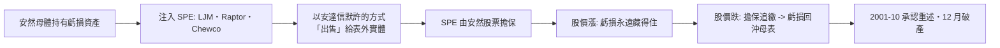

# 第八篇 第十章 第一節：安然與 SPE 迷宮——會計如何變成魔術

> 2001 年 12 月 2 日，**安然（Enron）**聲請破產——**當時美國史上最大破產案**，市值曾達 700 億美元的「**全美最受敬佩公司**」七週內歸零。核心手法：**特殊目的實體（SPE）**——把虧損與負債藏進「表外」的合夥（Raptors、LJM、Chewco），**用自家股票擔保、用衍生品「確認」未來收益**。兩萬名員工的 401(k) 被鎖在自家股票裡一同蒸發；**安達信（Arthur Andersen）**審計帝國同週崩塌。本節拆解：**當「規則會計」遇上「設計者」，披露義務如何被專業術語絞殺**。

## 一、前因：三個條件的相遇

1. **「重資產轉輕資產」的敘事**：安然從天然氣管線公司轉型為「**能源批發交易商**」——**利潤模型從「收過路費」變成「mark-to-market 的交易帳」**——**長期合約的未來利潤可以「今天就入帳」**；
2. **「SPE 的合法起源」**：表外融資本為**飛機租賃、影片融資**等正當用途——**規則會計（rules-based GAAP）只問「形式上是否達到 3% 外部資本」**——**設計者把 3% 做出來，其餘全是魔術**（原則會計 vs 規則會計的分水嶺）；
3. **政治與文化的護航**：**休士頓、布希家族、華爾街承銷、五大的安達信**——**「明星公司」無人敢深查**（麥道夫的光環效應，第 9 章）。

## 二、機器的解剖

1. **「自體循環擔保」**：**用自家股票給「買走自家虧損」的實體作保**——**皮包擔保皮包**——股價一跌，全鏈同崩；
2. **「 mark-to-market 的時間差」**：二十年能源合約的「預期利潤」**第一天就全額入帳**——**利潤是「估的」**，而估的人有股票選擇權——**會計估計淪為薪酬工具**；
3. **「巴爾薩澤式崩潰」**：2001 年 8 月副總裁**沃特金斯（Sherron Watkins）**匿名信警示、10 月第三季報**重述 1997–2001 財報**、11 月動態評級降級觸發擔保、12 月破產——**從警示到歸零只用了四個月**。

## 三、後果：立法的「大爆炸」

1. **《薩班斯–奧克斯利法》（SOX, 2002）**：**內控證明（302/404）、審計獨立委員會、審計輪替、刑事化財報造假（最高 20 年）**——**美國公司治理六十年來最大的單次改造**；
2. **安達信的死亡**：**銷毀文件被起訴（後遭最高法院推翻）**，但**客戶已全數逃離**——**「信譽之死」比定罪更快**；
3. **會計的哲學轉向**：**「原則導向（principles-based）」**開始挑戰規則導向——**SEC 與 IFRS 的長期辯論**由此開啟；
4. **世界通（WorldCom）的同年補刀**：2002 年 6 月**38 億美元「線路成本」資本化**虛增利潤（最終 110 億），CEO 埃伯斯入獄 25 年——**兩案合力把「企業詐欺」推上世紀議程**，並直接促成了**舉報人保護與 SOX 806 條款**。

---

*下一節：2000 年代的治理反思——參見 [10.2 世通與審計的制度性失靈](10.2-世通與審計失靈.md)*