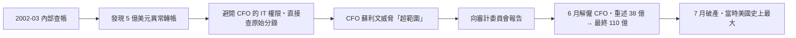

# 第八篇 第十章 第二節：世通與審計的制度性失靈——「誠實的數字」為何總是缺席

> 2002 年 6 月 20 日，**世通（WorldCom）**內部審計主管**辛西亞·庫珀（Cynthia Cooper）**率領三人小組，在深夜翻查總帳：**380 億美元的「線路成本」（日常費用）被悄悄轉記為「資本支出」**——**費用變資產，利潤憑空出現**。這是**史上第一次由內部審計揭露的巨型財報詐欺**。同年，泰科（Tyco）的 CEO 被控挪用、Adelphia 的 Rigas 家族把公司當自家錢包——**「審計為什麼總是最後一個知道」成為世紀之問**。本節拆解：**審計行業的商業模式如何系統性地妨礙它誠實**。

## 一、前因：審計的三重利益衝突

1. **「客戶付費」的悖論**：審計費由被審計公司支付——**「解僱審計師」是 CEO 的合法武器**——安然的安達信每年從安然賺 5,200 萬美元（審計僅 2,500 萬，其餘是顧問費）——**「顧問費 > 審計費」**是失靈的價格信號；
2. **「輪替的缺失」**：安達信審安然**十幾年**、畢馬威審世通同樣長期——**「關係的沉澱」使質疑變成「背叛」**；
3. **「合夥人激勵」**：事務所以**合夥人拉業務的能力**晉升——**「說不」的成本由個人承擔，「說好」的收益由全所分享**。

## 二、庫珀的「夜間審計」

1. **「內審的直接通道」**：庫珀**越過管理層、直達董事會審計委員會**——**這條通道在 SOX 之後成為法定義務**——**制度已存在、缺的是用它的人**；
2. **「資本化」的會計魔法**：把當期費用記成「建設中的網路資產」——**利潤立刻出現、成本推給未來**——與安然的 mark-to-market 同類：**「把時間軸折彎」是財報詐欺的統一原理**；
3. **「後果的量級」**：世通破產取代安然成為美國史上最大（直到 2008 雷曼）；**17,000 員工失業、投資者損失 1,800 億美元級**；埃伯斯被判 25 年。

## 三、後果：審計業的「外科手術」

1. **PCAOB（2002）**：**審計業首次被「外部行業監管機構」監督**——**自律時代的終結**；
2. **業務分離**：**審計事務所不得向審計客戶提供大量非審計服務**——**利益衝突被立法切斷**（執行力至今仍受「顧問化」侵蝕——2020s 四大顧問業務再度膨脹）；
3. **「吹哨」的制度化**：**SOX 806＋多德–法蘭克吹哨人辦公室（2011，獎金最高 30%）**——**庫珀們從「英雄敘事」變成「有經濟保護的職業選項」**；
4. **「內審的職業化」**：IIA 的國際準則強化、**「直屬審計委員會」成為上市公司治理標配**——**世通之夜成為全球內審教材的第一課**；
5. **「同構的重演」**：2008 雷曼的 Repo 105（表外藏槓桿）、2020 Wirecard（審計行不確認銀行餘額）、2022 FTX（內部帳與外部帳兩套）——**「審計最後知道」的劇本，每十年重演一次**（見《會計的故事》相關章節、《金融的故事》10 章）。

---

*下一章：2010 年代的「明星敘事詐欺」——參見 [11.1 Theranos 的一滴血](11.1-Theranos的一滴血.md)*