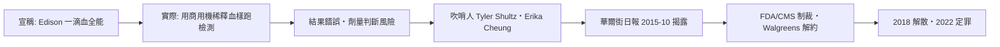

# 第九篇 第十一章 第一節：Theranos 的一滴血——「科技敘事」如何綁架專業判斷

> 2003 年，19 歲的史丹佛輟學生**伊麗莎白·霍姆斯（Elizabeth Holmes）**創立**Theranos**，宣稱**一滴指血、數百項檢測、幾美元的成本**——估值一度 90 億美元，她本人成為**全球媒體的「女版喬布斯」**。2015 年《華爾街日報》記者**卡瑞喬（John Carreyrou）**依內部吹哨人爆料揭穿：**裝置根本做不到**——實際檢測用的是**改裝的西門子商用機**，且結果錯誤率驚人。2018 年公司解散；2022 年霍姆斯被判**詐欺罪成立、入獄 11 年**。本節拆解：**當「敘事」成為融資工具、當董事會沒有專業眼睛，硬科技詐欺如何運轉十年**。

## 一、前因：風險投資文化的三個盲點

1. **「講故事的估值」**：矽谷的**「fake it till you make it」文化**——**演示與產品的界線被默許模糊**——但**醫療器件需要 FDA 驗證，這不是軟體迭代**；
2. **「董事會的明星缺位」**：董事會有**基辛格、舒爾茨、馬蒂斯**——全是外交與軍事名人，**沒有一位診斷學或體外診斷（IVD）專家**——**「權威不等於專業」**；
3. **「保密的極端化」**：實驗室禁拍、員工簽 NDA、部門互相隔離——**「喬布斯式保密」被用來掩蓋「機器不行」**（對照 8.1 維斯科的離岸保密——**保密的理由從「競爭」變成「遮醜」**）。

## 二、機器的運轉與崩塌

1. **「專業供應商的沉默」**：西門子知道自己的機器被改裝濫用卻未揭發——**「商業關係」使產業鏈集體沉默**；
2. **「吹哨的代價」**：**Tyler Shultz（國務卿舒爾茨之孫）**被威脅訴訟、家人關係被公司用來施壓——**「用訴訟成本壓垮個人」是詐欺企業的標準防禦**（馬可波羅斯對麥道夫的孤立無援，第 9 章——**但 2010 年代社交媒體 + 調查記者改變了平衡**）；
3. **「投資人的驗證惰性」**：硅谷頂級 VC 與媒體**均未要求臨床數據**——**「估值共識」替代了「證據」**——**這正是 2020 年代 AI 泡沫的風險劇本**。

## 三、後果

1. **「健康科技」的監管收緊**：FDA 對 LDT（實驗室自研檢測）的執法態度轉硬；CMS 對實驗室認證（CLIA）加嚴；
2. **創投的「技術盡調」回歸**：**董事會設置技術專家、要求臨床數據**成為健康類投資的門檻——**Theranos 成為商學院的「敘事風險」案例**；
3. **「女主創始人」的複雜遺產**：霍姆斯案的討論**夾雜性別偏誤與技術烏托邦**——**「信任敘事」與「驗證缺位」的關係，遠比個人性格更結構性**；
4. **同構的預言**：四年後，**Wirecard（2020）**以「總部裡不存在的銀行帳戶」重演了「敘事 > 證據」——**審計與盡調的雙失靈**（下一節）。

---

*下一節：Wirecard——參見 [11.2 Wirecard 的十九億歐元幽靈](11.2-Wirecard的十九億歐元幽靈.md)*