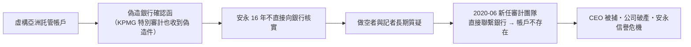

# 第九篇 第十一章 第二節：Wirecard 的十九億歐元幽靈——當審計行「無法確認銀行餘額」

> 2020 年 6 月 18 日，德國支付公司**Wirecard**（DAX 30 成分股）承認：**帳上 19 億歐元的「亞洲託管現金」不存在**——**銀行確認函是偽造的**。一週內公司破產、CEO 馬庫斯·布勞恩被捕；長期審計師**安永（Ernst & Young）**十六年間**從未親自向銀行核實**。**FT（金融時報）記者追查五年、遭德國政府以「操縱市場」立案調查記者本人**——**監管（BaFin）不查公司、反查吹哨者**。這是歐洲史上最大的會計醜聞，也是**「監管俘虜」的當代標本**。

## 一、前因：一座「德國科技燈塔」的建造

1. **「支付科技」的敘事地位**：Wirecard 被包裝成**德國版的 PayPal／Visa**——**「數字化轉型」的國家敘事**使監管與政界不願潑冷水；
2. **「亞洲三分之二的利潤」**：利潤來自**杜拜與菲律賓的「第三方收單夥伴」**——**收入真實性永遠無法在德國境內驗證**（與 5.2 莫里斯的「看不見的土地」同構）；
3. **監管的結構分裂**：**BaFin 管市場、聯邦審計師公會管審計、央行管支付牌照**——**三不管的縫隙正是結構所在**；且 BaFin 曾**做空禁令 + 立案調查 FT 記者**——**「保護股價」凌駕「查證真相」**。

## 二、機制的解剖

1. **「確認函依賴症」**：審計慣例允許**「客戶轉交的銀行回函」**——**詐欺者直接偽造回函**——**審計程序的「信任鏈」被一封偽造的信穿透**；
2. **KPMG 的 2020 特別審計**：因「無法確認第三方資金存在」而出具**「無法表示意見」**——**特別審計已亮紅燈，常規審計仍繼續**——**審計內部的「程序主義」**：每一步都合規，整體是假的；
3. **「吹哨者生態」的兩面**：FT 記者 Dan McCrum 被跟蹤、被調查；**內部人員與做空機構**提供了關鍵證據——**「做空研究＋調查報導」成為事實上的市場稽查**（對照 9.2 馬可波羅斯的孤軍——**2010 年代後「公開揭露」的路徑升級**）。

## 三、後果

1. **德國審計監管重組**：審計監督權移交**APAS 的強化版本**、**「審計師強制輪換（10 年）」**立法推進——**直接針對「16 年安永」**；
2. **BaFin 的改組**：設立**類 SEC 的集中執法能力**——**「記者被調查」成為德國金融監管的世紀恥辱案例**；
3. **歐洲的系統性反思**：**審計報告的「關鍵查核事項」、銀行直接核實的標準化、對「境外收入占比過高」的強制風險評估**——**Wirecard 成為歐盟審計改革的標尺**；
4. **「數字支付」的神話破滅**：Fintech 估值模型被重寫——**「收入在境外、資產看不見」的商業模式**自此成為投資委員會的一票否決項（對照 12 章 FTX 的巴哈馬結構——**看不見的帳，永遠要先當作不存在**）。

---

*下一章：2020 年代的加密詐欺——參見 [12.1 Terra/Luna 的算法死亡螺旋](12.1-TerraLuna的算法死亡螺旋.md)*