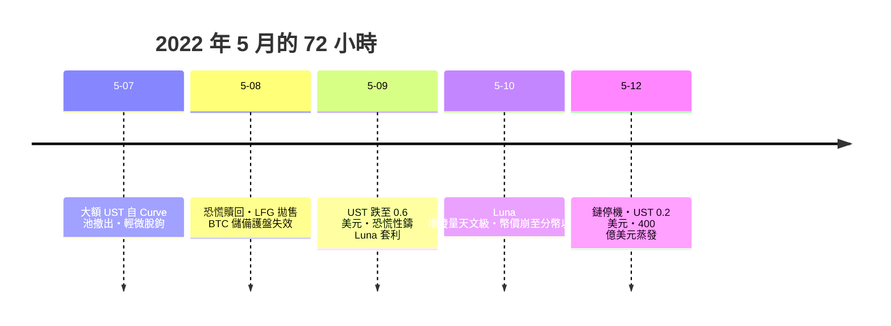

# 第十篇 第十二章 第一節：Terra/Luna 的算法死亡螺旋——「20% 存息」的數學謊言

> 2022 年 5 月，韓國創業者**權度亨（Do Kwon）**的**Terra 生態**在一週內蒸發約 **400 億美元**：**算法穩定幣 UST** 與其治理代幣 **Luna** 以「**雙幣鑄造**」互相錨定；其**借貸平台 Anchor 以 20% 年息**吸儲——**UST 市值約 75% 沉在 Anchor 的 20% 利率裡**。5 月 7 日大額贖回觸發脫鉤，**Luna 從 80 美元跌到 0.0001 美元**——**「死亡螺旋」在 72 小時內走完**。韓國通緝權度亨，2023 年他在黑山被捕，2024 年引渡美國認罪。本節拆解：**「沒有資產儲備的錨定」如何用數學語言復刻龐氏**。

## 一、前因：算法穩定幣的誘惑

1. **「去中心化穩定幣」的執念**：USDT/USDC 依賴**銀行帳戶與審計（中心化）**——**算法派宣稱「用程式代替儲備」**——**這正是 4.1 約翰勞「紙鈔代替金屬」的加密版**；
2. **雙幣機制**：**1 UST 可鑄 1 美元等值的 Luna**（銷毀）；反之亦然——**套利者應在脫鉤時買 UST 鑄 Luna 套利、推回錨定**——**前提是 Luna 本身有價值**——**「用自己股票擔保自己負債」**（安然 SPE 的加密版，第 10 章）；
3. **Anchor 的 20%**：**儲備補貼遠低於利息支出**——**利息是「用新鑄造的 Luna 發的」**——**龐氏支付的最純粹形態**（第 7 章）。

## 二、死亡螺旋的七天

1. **「螺旋的數學」**：UST 跌 → 套利者鑄大量 Luna 賣出 → **Luna 供給爆炸、價格崩** → 擔保價值更低 → **錨定更遠**——**反身性以小時為單位完成**；
2. **「儲備的最後掙扎」**：Luna Foundation Guard 手握約 30 億美元 BTC 企圖護盤——**拋售 BTC 反而拖垮整個加密市場**——**「用一種資產護另一種資產的盤」的傳染性**（與 2008 年「賣資產補保證金」同構）；
3. **「社群的信仰經濟」**：權度亨在推特上嘲諷質疑者（「**我不和窮人辯論**」）——**敘事自信是 2010 年代後詐欺的統一臉孔**（Theranos 第 11 章、FTX 12.2）。

## 三、後果

1. **「算法穩定幣」的死刑判決**：此後**監管普遍要求穩定幣 1:1 儲備＋月度審計**（歐盟 MiCA 的穩定幣專章直接以此案為動機）；
2. **「儲備金去哪了」的追訴**：調查發現**LFG 的 BTC 在崩盤前後被轉移至韓國交易所**——**「鏈上可追蹤」第一次成為主權跨國執法的日常工具**（11.2 的鏈上分析譜系）；
3. **思想遺產**：**「沒有儲備的錨定是修辭」**——從交子（3.1）的準備金，到 19 世紀鈔票折扣（6.2），到 UST——**四百年來「錨定」的答案從來都是「真實資產放在誰手裡」**；下一節的 FTX 給出反向案例：**有真實客戶資產，也會被偷**。

---

*下一節：FTX——參見 [12.2 FTX 的客戶資產去哪了](12.2-FTX的客戶資產去哪了.md)*