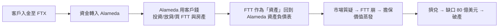

# 第十篇 第十二章 第二節：FTX 的客戶資產去哪了——「三位一體」結構的最後演出

> 2022 年 11 月 2 日，CoinDesk 公佈**Alameda Research（FTX 關聯做市商）的資產負債表**：**146 億美元資產中，最大一項是 FTX 自家發行的代幣 FTT**——**「交易所的儲備是自己的欠條」**。11 月 6 日 Binance 宣布拋售 FTT，擠兌開始；11 月 8 日 FTX 求購於 Binance 又告吹；**11 月 11 日 FTX 與 130 家關聯公司聲請破產**，**逾 800 萬用戶、80 億美元級客戶資產缺口**。12 月，CEO **Sam Bankman-Fried（SBF）**被捕——**2024 年被判 25 年**。本節拆解：**「客戶資產=公司資產」的挪用如何在「有效利他主義」的敘事外衣下完成**。

## 一、前因：結構與文化的雙重失守

1. **「三位一體」的結構**：**FTX（交易所）＋ Alameda（做市商）＋ FTT（自家代幣）**——**撮合方、交易方、抵押品發行方同一老闆**——與麥道夫「經理人＝託管人＝經紀商」完全同構（第 9 章）；
2. **「巴哈馬」的選址**：註冊於執法資源薄弱的巴哈馬——**8.1 維斯科的四十年前劇本**；
3. **「治理的真空」**：內控缺失、以 Slack 私訊下指令、**會計部門形同虛設**——破產後的新管理層直言**「見過最差的公司治理」**——**「天才工程師敘事」豁免了程序**（Theranos 的董事會真空，第 11 章）。

## 二、挪用的機器

1. **「自家代幣當儲備」**：**FTT 是零成本發行的「資產」**——**用欠條擔保欠條**（安然自體擔保，第 10 章；UST 的 Luna 螺旋，12.1）；
2. **「內部帳與外部帳」**：客戶餘額只是**數據庫裡的數字**——**鏈上可驗證性被「託管式交易所」架空**——**12.1 的教訓「錨定要看資產在誰手裡」再次應驗**；
3. **「崩盤的傳染」**：FTX 破產波及**BlockFi、Genesis、Voyager**等債權網——**「關聯融資網」使單點詐欺變成行業危機**（儲貸危機的加密版，8.2）。

## 三、後果

1. **「儲備證明（PoR）」的興起**：交易所被迫公開**Merkle 樹客戶餘額證明＋第三方審計**——**「不要信任、要驗證」從口號變成披露標準**；
2. **執法的里程碑**：**巴哈馬–美國的引渡、鏈上資金追蹤、25 年刑期**——**與維斯科（8.1）對照：四十年間「跨國詐欺執法」終於有了牙齒**；
3. **敘事的破產**：**「有效利他」與「監管友好」的公共形象**沒能替代**任何一項基本內控**——**本書的主題在此閉環**：從哈格斯特拉圖斯的沉船（1.1）到 SBF 的 Slack 私訊——**技術與敘事在變，「挪用他人託付」的結構從未變**；
4. **監管的長影響**：**客戶資產隔離**成為全球加密立法（歐盟 MiCA、香港 VASP 制度）的核心條款——**1900 年代「銀行不得混用客戶證券」的原則，在 2022 年被第三次重新發明**。

---

---

*全書總結與詐欺的未來——參見 [結語](13.1-結語：詐欺的恆定結構.md)*