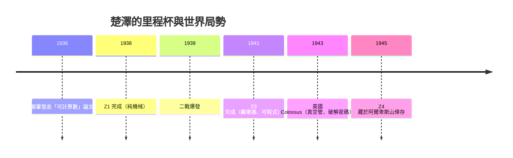

# 1.1 康拉德·楚澤的 Z 系列機械計算機：繼電器電路中的二進制運算先驅

> 「在希特勒的陰影下，一個被徵召的建築工程師，獨自發明了數位電腦。」——這是計算機史上最孤獨也最驚人的成就之一。

## 一、孤獨的發明者

1935 年，25 歲的康拉德·楚澤（Konrad Zuse）在柏林的 Henschel 飛機公司擔任結構工程師。當時的工程計算——樑的撓度、振動頻率——需要解數十個線性聯立方程式，靠人手持計算尺與機械加法器，枯燥且錯誤百出。楚澤厭倦了這種「機械式的腦力苦役」，決定造一台機器代替人計算。

他做出兩個影響深遠的決定：

1. **採用二進制**。機械式計算機（如 CURTA、IBM 的打孔卡機）都是十進制，但楚澤意識到「開關只有兩種狀態」，二進制才是最適合機器的語言。他讀過萊布尼茨 1679 年的二進制論文，也受益於喬治·布爾（George Boole）1854 年的邏輯代數——「邏輯可以計算」這一思想，正是 CPU 的哲學源頭。
2. **放棄機械齒輪，改用電磁繼電器**。繼電器本質上是一個「電控制的開關」，開與關恰好對應 1 與 0，也對應布爾邏輯的真與假。

## 二、Z1 到 Z3：從臥室的木板上造出電腦

楚澤在父母的客廳裡，用自己的錢、靠朋友與家人的贊助，先後造出：

| 機器 | 年份 | 關鍵特徵 |
|------|------|----------|
| Z1 | 1938 | 純機械，約 3 萬個金屬片，常故障 |
| Z2 | 1939 | 電話繼電器改造，二進制運算器 |
| Z3 | 1941 | **全球第一台可程式的圖靈完備計算機**，2,600 個繼電器 |
| Z4 | 1945 | 唯一倖存，戰後成為歐陸唯一運轉中的電腦 |

Z3 的關鍵規格：22 位元浮點數運算、每秒約 5–10 次加法、程式從廢棄的 35mm 電影膠片上打孔讀入。1998 年，計算機科學家 Raúl Rojas 證明 Z3 是**圖靈完備**的——它與現代 CPU 在計算能力上本質相同。

## 三、為什麼德國錯過了電腦霸權？

Z3 曾提交給德國航空研究院（DVL）評估，卻被拒絕資助後續研發。原因值得深思：

- **制度與政治**：納粹官僚體系迷信「決定性的武器」（如 V2 火箭），認為戰爭會在兩年內結束，不值得投資長期研究。楚澤申請資助的信件石沉大海。
- **文化因素**：德國大學的「純理論」傳統鄙視工程實作；而美國有 MIT 的輻射實驗室、貝爾實驗室這類「工程與科學混血」的機構。
- **孤島效應**：楚澤完全不知道圖靈、Atanasoff、Aiken 的工作。戰爭隔絕了學術共同體，導致天才各自重複發明輪子。

戰後楚澤無法從英美的電子電腦潮流中獲利，轉而創辦 Zuse KG 公司（1949），一度是歐洲最大的電腦公司，1967 年被西門子收購。他晚年轉而研究「計算空間」（Rechnender Raum）——一種類似後來「宇宙即計算」的物理哲學。

## 四、繼電器的天花板

繼電器靠金屬簧片機械動作，速度每秒只能開關數十次，而且簧片會磨損、卡死、被灰塵干擾。要更快，就必須讓「開關」變成純電子、無機械動作的東西——**真空管**。這正是下一節 ENIAC 的故事。

> **歷史因果鏈**：布爾邏輯（1854）→ 萊布尼茨二進制的再發現 → 楚澤用繼電器證明「開關可以運算」→ 繼電器的速度極限逼出真空管 → 電晶體。每一代「開關技術」的天花板，就是下一代技術的起跑線。
