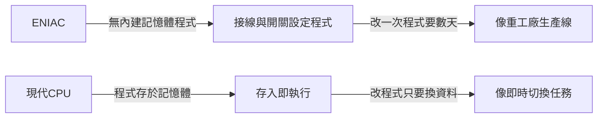

# 1.2 ENIAC 的真空管陣列：每秒三千次運算、隨時會燒毀玻璃管的龐然大物

> 「它每秒算三千次加法，但它每兩天就會燒壞一根真空管。」——戰爭催生了人類第一台通用電子計算機，也催生了「除錯」這個職業。

## 一、戰爭是最強的研發預算

1943 年，美國陸軍彈道研究實驗室（BRL）面臨絕望的問題：新型火砲的**彈道表**。一張彈道表需要計算數百條彈道，每條彈道需要求解空氣阻力下的非線性微分方程。當時靠「人肉計算機」——上百名使用機械計算器的女性計算員（computers 一詞原本指「人」）——一張表要算一個月，而前線需要的是幾十張表。

賓州大學摩爾電機學院的約翰·莫奇利（John Mauchly）與年輕的工程師 J. 普雷斯珀·埃克特（J. Presper Eckert）提出瘋狂方案：用 **17,468 根真空管**造一台電子計算機。陸軍批准了——這是典型的戰時邏輯：「燒錢但值得」。

## 二、ENIAC：一座會算術的建築物

1945 年底完成的 ENIAC（Electronic Numerical Integrator and Computer）：

| 項目 | 數據 |
|------|------|
| 真空管 | 17,468 根 |
| 繼電器 | 7,200 個二極體（晶體二極體） |
| 重量 | 27 噸 |
| 佔地 | 167 平方公尺 |
| 功耗 | 150 kW（據說費城電網會因此燈光變暗） |
| 速度 | 每秒約 5,000 次加法——比機械計算機快 1,000 倍 |

它與現代 CPU 的哲學差異極大：

ENIAC 沒有「儲存程式」的概念——程式是用**接線、插頭與旋鈕**設定的。計算一條彈道前的設定工作需要幾天，而計算只要幾秒。這個荒謬的比例（設定遠大於計算）直接催生了下一節的「馮·諾伊曼架構」。

## 三、真空管：電子開關的第一代王者

真空管的原理：在真空玻璃管中，加熱的陰極發射電子，柵極電壓控制電子能否到達陽極——**用電壓控制電流，就是開關**。相較繼電器，它沒有機械動作，每秒可開關百萬次。

但它的缺陷也是致命的：

1. **燈絲會燒斷**（像燈泡），平均壽命數千小時。17,468 根管子，每天燒壞數根。
2. **發熱巨大**，冷卻問題困擾始終。
3. **昂貴且耗電**。

ENIAC 團隊的對策：工程師發現**多數故障發生在開機時**（燈絲的冷熱衝擊），於是乾脆**永不關機**——這就是「伺服器不關機」文化的遠祖。找出故障管子的過程催生了「除錯」（debugging）與現場可替換單元（field-replaceable unit）的維修思想。

有趣的是，1945 年 9 月 9 日，哈佛 Mark II 的工程師在繼電器中夾出一隻飛蛾，貼在日誌上寫道「發現第一隻實際的蟲（bug）」——葛麗絲·霍普（Grace Hopper）讓這個故事流傳至今，成為除錯文化的經典神話。

## 四、經濟與政治：ENIAC 之後的商業戰爭

1946 年 ENIAC 公開後，莫奇利與埃克特想將電腦商業化，卻因賓州大學主張專利歸屬學校而憤而離職，創辦 Eckert–Mauchly Computer Corporation，造出第一台商用電腦 UNIVAC I（1951）。公司資金鏈斷裂後被 Remington Rand 收購；1950 年代，UNIVAC 在電視上「預測」艾森豪當選總統成功，讓「電腦」一詞進入大眾文化。

而 IBM——原本靠打孔卡機賺錢——被這波浪潮驚醒，推出 IBM 701 系列，憑藉銷售、維修、金融租賃的全面能力，在 1960 年代拿下市場七成，被稱為「IBM 與七個小矮人」。**戰爭點火、學院孵化、企業收割**——這個模式在後來的半導體史中不斷重演（積體電路由軍用飛彈與阿波羅計畫買單，就是下一章的主線）。

> **歷史因果鏈**：彈道表需求（軍事）→ ENIAC（真空管證明電子計算可行）→ 設定程式太慢的痛點 → 馮·諾伊曼架構（下一節）→ 真空管的可靠性極限 → 電晶體（第二章）。
